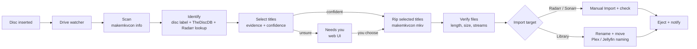
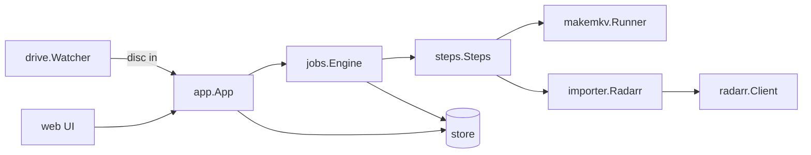
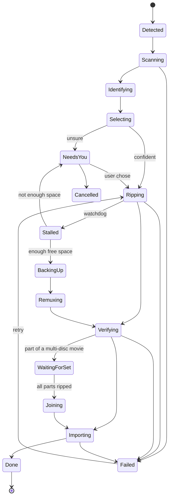

# Trayarr: design

**Status:** draft, 2026-11-13. Decisions D1–D12 were accepted by the owner on 2026-11-13. A new decision starts as **Proposed** and becomes **Accepted** once the owner approves it. The decision log (section 17) holds the reasons.

Trayarr turns a disc in a drive into a correctly named file in your library, with no clicks when it is sure and one question when it is not. It runs MakeMKV, works out which titles on the disc are the movie or the episodes, rips only those, and hands them to Radarr or Sonarr, or files them itself.

---

## 1. Goals and non-goals

**Goals**

1. **Pick the right titles.** Pick the main feature on discs that hide it among hundreds of fake playlists. This is the core of the project, and it is measured (section 8), not claimed.
2. **Be safe when automatic.** Import on its own only when the evidence agrees; otherwise stop and ask. A wrong import costs more than a question.
3. **Work with or without the \*arr stack.** Two import targets, chosen in settings:
   - **Radarr/Sonarr:** import through their own Manual Import, check that it worked, and add missing movies as unmonitored.
   - **Library:** for users without Radarr or Sonarr, Trayarr renames and moves the files itself, with Plex/Jellyfin naming.
4. **Run like infrastructure.** A small container, a clean shutdown, recovery from a crash, Prometheus metrics, health checks, signed releases.
5. **Stay legally clean to publish.** MakeMKV is never in the repo or the image; each user installs it, accepts its EULA and brings a key.

**Non-goals (for v1)**

- Transcoding. Rips stay as remuxes. Tools like Tdarr or Rexarr do encoding.
- Audio CDs, data discs, game discs.
- Windows and macOS hosts. Trayarr runs in a Linux container.
- Anything that downloads or shares media. Trayarr only reads discs you put in.
- Writing our own decryption. MakeMKV does that (decision D2).

---

## 2. The big picture



Each box is a step in a **job**. A job is one disc's trip through this flow, and it is saved to a database after every step, so a restart picks up where it stopped (section 6).

---

## 3. Background you need

Short versions of the concepts the rest of the document relies on.

**How a Blu-ray is laid out.** The video sits in **clips** (`BDMV/STREAM/00012.m2ts`). A **playlist** (`BDMV/PLAYLIST/00800.mpls`) says which clips to play in which order. The movie is a playlist. So is each extra, the play-all, and each trailer. MakeMKV calls each playlist a **title**, and the list of clips it uses is its **segment map** (for example `"3,13,15,1"`).

**Fake playlists (obfuscation).** Some studios put hundreds of playlists on a disc. Each one is about the movie's length and uses the same clips in a shuffled order. Only one plays the film correctly; the disc's Java menu (BD-J) knows which. A ripper that picks "the longest title" gets a jumbled film. In TheDiscDB's data the longest title is not the main movie on **192 of 2,627** movie discs (**7.3%**), and the worst have 400–528 titles (*Despicable Me*, *La La Land*, *Toy Story 4*, *Coco*).

**makemkvcon and robot mode.** `makemkvcon` is MakeMKV's command-line engine (closed source). With `-r` it prints one machine-readable line per fact:

```
TCOUNT:42                          how many titles
TINFO:3,9,0,"1:58:12"              title 3, attribute 9 (duration)
TINFO:3,16,0,"00800.mpls"          title 3, attribute 16 (source playlist)
TINFO:3,26,0,"3,13,15,1"           title 3, attribute 26 (segment map)
SINFO:3,1,19,0,"1920x1080"         title 3, stream 1, attribute 19 (resolution)
MSG:5010,0,0,"Failed to open disc" a message with a numeric code
PRGV:120,450,65536                 progress (current, total, max)
```

Attribute numbers come from `apdefs.h` in the open-source `makemkv-oss` package. Trayarr parses these lines; it never scrapes human-readable text.

**MakeMKV's own main-feature guess.** On fake-playlist discs MakeMKV can run the disc's Java menu and mark the title the menu would play. The output file name then contains `SEG_MainFeature`. It needs a Java runtime in the container, and it is a strong hint, not proof.

**TheDiscDB.** A community, MIT-licensed catalogue of specific disc releases. For each disc it lists every title MakeMKV shows, with its playlist file, segment map, duration and size, and says what each title is (`MainMovie`, `Episode`, `Extra`, ...). It also stores a `ContentHash` per disc. 3,114 movie discs and 255 series are in the dataset today. This lets you identify a disc **by its shape** (which playlists, how long), which is far more reliable than its label.

**Radarr/Sonarr Manual Import.** The API the web UI's "Manual Import" button uses: scan a folder (`GET /api/v3/manualimport?folder=…`), then send a `ManualImport` command naming the movie (or episodes), the quality and `importMode: move`. Radarr then renames and files the file by its own rules. That keeps naming in one place, the user's \*arr settings.

---

## 4. Architecture

One Go program (decision D1), one process, one container. Inside it, packages with one job each:


| Package | Responsibility | Talks to the outside? |
|---|---|---|
| `drive` | Notices discs going in and out, reads the label, ejects. | Linux sysfs and ioctl |
| `makemkv` | Installs MakeMKV, runs `makemkvcon`, parses robot output into Go types, reports progress. | the `makemkvcon` process |
| `discdb` | Keeps a local copy of TheDiscDB's data and an index to look discs up by shape. | git/HTTPS, once a day |
| `identify` | Turns a scan into "which movie or show is this": label clean-up, editions, TheDiscDB, Radarr/Sonarr lookup. | Radarr/Sonarr lookup API |
| `selector` | Decides which titles to rip and how sure it is. **Pure functions: no I/O.** | no |
| `importer` | Radarr, Sonarr and "library" (no \*arr) targets behind one interface. | Radarr/Sonarr API, filesystem |
| `jobs` | The state machine that moves a disc through the steps, one worker per drive. | via the packages above |
| `store` | SQLite: jobs, their history, settings. | the database file |
| `web` | Server-rendered pages and a JSON API on the same data. | HTTP |
| `metrics` | Prometheus counters and histograms, structured logs. | `/metrics` |

**Why these boundaries.**

- **`selector` has no I/O.** Everything it needs (the scan, the TheDiscDB candidates, the library state) is passed in as plain data, and it returns a decision with reasons. That makes the most important logic the easiest to test and to benchmark: run it on 2,627 discs in seconds, no drive needed.
- **`makemkv` is the only package that knows MakeMKV exists.** Everything else sees `Disc` and `Title` structs. If MakeMKV changes its output, one package changes. Tests replace it with a fake that replays recorded output (section 13).
- **`importer` is an interface.** Radarr, Sonarr and Library each implement `Plan(job) → ImportPlan` and `Apply(plan) → Result`. The job logic does not know which one it is talking to, so offering "with or without Radarr" is one setting, not two code paths. Adding another target later does not touch the job logic.
- **One worker per drive.** Each drive gets its own goroutine, so two drives rip at once. They share one MakeMKV install and one database.

**Repository layout** (Go convention: `cmd/` for programs, `internal/` for packages no one else may import):

```
cmd/trayarr/          the server
cmd/trayarr-bench/    the title-selection benchmark (section 8)
internal/drive/  internal/makemkv/  internal/discdb/  internal/identify/
internal/selector/  internal/importer/  internal/jobs/  internal/store/
internal/web/  internal/metrics/
testdata/             recorded makemkvcon output, small TheDiscDB samples
deploy/               Dockerfile, compose example, TrueNAS notes
docs/                 this file, ADRs, user guide
```

---

### How v0.1 is wired



- **`cmd/trayarr`** reads the settings, builds the parts and starts them. On SIGTERM it stops the web server first, so nobody starts new work, then gives running jobs 25 s to reach a safe point. A rip stops and resumes at the next start; an import finishes.
- **`internal/app`** is the glue:
  - it starts a job's run when a disc goes in or the user approves or retries;
  - it resumes unfinished jobs at start;
  - it ejects the disc when a job is done;
  - it reports health: the database, makemkvcon and Radarr.
- **`internal/steps`** is the real `jobs.Steps`:
  - **Select** suggests MakeMKV's main-feature title, otherwise the longest. It is never automatic in v0.1.
  - **CheckDisc** first asks the drive watcher whether the tray has changed since the job's scan; the watcher counts every change. If not, the disc can't have been swapped, and nothing is read. Otherwise (a tray change, a restart, or a system where drives can't be watched) it rescans and compares the result with the job's scan. A label alone can't tell discs apart, because generic labels are common.
  - **Rip** rips each chosen title into its own subfolder (the watchdog needs an empty one) and moves the file up into the job's folder.
  - **Verify** checks that there is one file per title, and that each is 70–110% of the size the scan gave it. A rip that stopped early fails here: the Kill Bill stall was under 1%. The bounds are wide until real rips have been measured.
- **`internal/drive`** asks the kernel for the tray state (`CDROM_DRIVE_STATUS`) every 2 s.
  - Only a *change* to "disc ready" starts a job. A disc already in the tray when Trayarr starts is left alone, because it may be one that was finished before a restart. The UI's Scan disc button starts it.
  - A disc that goes in while the drive still has a job (one waiting for approval, say) is remembered, and the dashboard marks the drive "new disc waiting". It gets its own job as soon as the current one ends (done, failed or cancelled), and it isn't ejected when the old job finishes.
  - On Windows and macOS there is no drive control: the Scan button is the only way to start a job.
- **Running it without hardware.** `cmd/fake-makemkvcon` and `cmd/fake-radarr` stand in for MakeMKV and Radarr. The README shows how to run the whole app with them, and `internal/app`'s end-to-end tests do the same.

## 5. A disc's journey, step by step

1. **Detect.** `drive` checks each tray every 2 s through the kernel (`/sys/block/srN` and the `CDROM_DRIVE_STATUS` ioctl). It deliberately does **not** ask MakeMKV to list drives: that makes MakeMKV query every drive and can disturb a rip in progress (ARM and Rexarr both document this).
2. **Scan.** `makemkvcon -r --cache=1 info dev:/dev/sr0 --minlength=0` gives every title. Trayarr keeps short titles too, because they help identify the disc by shape.
3. **Identify.** In order of strength:
   1. TheDiscDB `ContentHash`, if one can be computed from the disc (to be confirmed, see open questions).
   2. TheDiscDB **shape match**: a disc whose titles line up with ours by playlist file, segment map, duration (±2 s) and size.
   3. The disc label, cleaned (`SOLO_A_STAR_WARS_STORY` → "Solo a Star Wars Story"), and searched:
      - **Radarr target:** through Radarr's lookup. Radarr proxies TMDb, so users need no separate TMDb key.
      - **Library target:** TheDiscDB's own `tmdb.json` covers the discs it knows. For the rest, Trayarr searches TMDb directly, which needs the user's free TMDb API key. Without one, unknown discs always go to Needs you.
4. **Select.** `selector` returns the titles to rip, a confidence level and the reasons (section 7).
5. **Decide.** If the confidence is high enough and the auto-import rules pass, continue. Otherwise the job waits in **Needs you** with the evidence shown.
6. **Rip.** `makemkvcon -r --progress=-same mkv dev:/dev/sr0 <title> <staging>` for each chosen title, into a per-job staging folder. Progress goes to the UI and to metrics. The **rip watchdog** watches the process the whole time. If the rip stalls, the job switches to the backup-and-remux strategy (section 9.3).
7. **Verify.** Check each file's duration and size against the scan, and that it has video and the expected audio. A short or empty rip fails here, not after import.

**Finishing is an event, not a silence.** Trayarr starts `makemkvcon` itself, so it knows when the process exits and with what result. A rip counts as finished only when the process exits successfully **and** the verify step passes. "The file stopped growing" never counts: that rule once announced a stalled 640 MiB rip as finished. Until verified, files stay in staging, where nothing else looks.
8. **Import**, through the target chosen in settings:
   - **Radarr:** look up the movie and add it unmonitored if missing. Scan the staging folder through Manual Import and send the import. Wait for the command, then confirm the movie now has a file of the expected quality.
   - **Library:** build the path from a naming template and move the file there. The default (Plex) is `Movies/Title (Year) {tmdb-123}/Title (Year) {tmdb-123}.mkv`, with `{edition-…}` added for editions. There is a Jellyfin preset as well. Trayarr then confirms the file is in place with the right size. It refuses to overwrite an existing file, and can optionally ask Plex or Jellyfin to rescan.
9. **Finish.** Eject, notify (webhook or Apprise), clean the staging folder.

**Staging lives on the same filesystem as the library**, so the final move is a rename: instant, atomic (a file is either fully there or not at all), and no double disk space. Trayarr checks this at startup and warns if it is not true, when `TRAYARR_LIBRARY_DIR` tells it where the library is: it compares the two folders' filesystem device ids.

---

### How the Radarr import is built (v0.1)

`internal/radarr` is a small client for the API calls Trayarr needs. `internal/importer` uses it. The flow keeps the lessons of the pipeline Trayarr grew out of.

**It refuses before sending anything:**
- a job with no movie;
- an empty staging folder;
- more than one file (v0.1 imports one title per movie);
- a movie Radarr already has a file for (there are no silent replacements);
- a video size it can't name a quality for;
- a folder outside the staging mapping.

**Then it imports:**
1. Ask Radarr to scan the job's staging folder, and use Radarr's own entry for the file. That way the path and languages are what Radarr itself read. This comes first, so a wrong path mapping fails before anything is added to the library.
2. If a Manual Import for this file is already running (a retry after a timeout), wait for that one instead of starting a second.
3. Otherwise, add the movie if it is missing. It is always added unmonitored, with no search, so Trayarr never makes Radarr download anything. That rule is in the client itself: a caller can't turn it on.
4. Set the movie and the quality on the entry. The quality object is Radarr's own, from its quality definitions, never built by hand. The grade is the higher of what the video's width and height say: a scope film stored as 1920x800 and an anamorphic 1440x1080 Blu-ray are both `Remux-1080p`.
5. Send a Manual Import with `importMode: move`.
6. Wait for *that* command's ID, not Radarr's whole queue. A few failed status checks in a row (Radarr restarting) are tolerated, because the command keeps running in Radarr regardless.

**It verifies the import happened.** Radarr has to say the movie has a file of the expected quality, *and* the file has to have left staging.

**Path mapping.** Trayarr and Radarr usually mount the same storage at different places. `PathMap` translates the staging folder, and refuses anything outside it, so it doubles as the guard on what Radarr is asked to import.

**Safe to rerun.** An empty staging folder plus a movie whose file Radarr added *after the job started* means the import already happened before a crash, so `Import` returns success without sending anything. If the movie's file is older than the job, it's the user's earlier copy: the rip has gone missing, and that is an error, not a success.

**Identify.** `internal/identify` cleans the disc label:
- `SOLO_A_STAR_WARS_STORY` becomes "Solo A Star Wars Story";
- disc words (`UHD`, `D1`, `Disc 1`) are dropped;
- a trailing `THE` moves to the front;
- an edition is set apart, but only at the end of the label, after the title ("Watchmen- Ultimate Cut"). Edition words elsewhere are part of the title: `UNCUT_GEMS`, `THE_FINAL_CUT`;
- a year counts only in brackets ("Spider-Man 3 (2007)"). A bare number is part of the title: `BLADE_RUNNER_2049`, `1917`;
- a generic label (`DVD_VIDEO`, `BD_ROM`, `VIDEO_TS`, `LOGICAL_VOLUME_ID`) gives no search term at all.

The volume label is tried first, then MakeMKV's disc name. Radarr's TMDb lookup does the search, and a result from the label's year wins. A raw label is never searched, since a generic one would match a random film. No match, or no usable label, is not an error: the user picks the movie in Needs you.

**API key.** It is sent in the `X-Api-Key` header, never in a URL, so it can't end up in a log line or an error message.

## 6. Jobs, state and recovery



- **Every transition is written to SQLite before the next step starts.** The database is the source of truth, not memory.
- **On restart**, each unfinished job is resumed by its state:
  - `Ripping`: the partial file is deleted and the rip starts again. A half-written rip is never trusted.
  - `BackingUp`: the partial backup folder is deleted and the backup starts again.
  - `Remuxing`: the partial MKV is deleted and the remux runs again from the backup, which is complete at this point.
  - `WaitingForSet`: stays waiting, with the finished parts kept in staging.
  - `Importing`: ask Radarr first whether the movie already has the file. Import steps are **idempotent**: running one twice does no harm, because each checks before acting.
  - `NeedsYou`: stays waiting.
- **Clean shutdown.** On `SIGTERM` (what `docker stop` sends), stop taking new discs, let a running import finish, and stop a running rip cleanly. The job is then resumed at the next start. The whole shutdown fits in 8 s (2 s for the web server, 6 s for jobs), inside the 10 s Docker allows after SIGTERM before it kills the container. A job still running then is safe to cut off: its state is saved, an interrupted rip starts again, and an interrupted import is picked up by the next start (the importer recognises a finished import, and joins one still running in Radarr).
- **One job per drive at a time.** A second disc in the same drive is only seen after the first job leaves the drive. The database enforces this too: a partial unique index on `jobs(drive)` covers only active states, so no bug in Go code can start two jobs on one drive.

### How it is built (v0.1)

- **The state machine is a table.** `internal/jobs/state.go` lists, for each state, the states it may move to. The engine refuses any other move. v0.1 has the states up to `Done`, `Failed` and `Cancelled`; the recovery states (`Stalled`, `BackingUp`, …) are added with the fallback in v0.2.
- **Every step is safe to run again,** so recovery needs no special code. After a restart, the engine runs the step that the saved state names:
  - Scan, identify, select and verify only read.
  - Ripping always starts by emptying the job's staging folder.
  - Import must check before it acts.
- **The disc is checked before every rip.** The user may have swapped discs while the job waited for approval, or while Trayarr was stopped. `Steps.CheckDisc` compares the drive's disc with the job's scan. On a mismatch, the job fails, and a retry starts over with a fresh scan.
- **Cancel and Run exclude each other.** Cancel takes the job's run slot while it works, so a Run starting at the same moment gets `ErrRunning` instead of starting a rip on a job that is being cancelled.
- **Progress has one writer.** Only `SetProgress` writes it. `Move` saves the fields the engine owns and leaves progress alone, so saving an older copy of a job can't wipe out how far the rip got.
- **Saving is compare-and-swap.** `Store.Move` updates the row only `WHERE id = ? AND state = ?` (the state the engine last read), and records the history event in the same transaction. A stale copy of a job can never overwrite a newer state.
- **Interrupted is not failed.** If a step stops because Trayarr is shutting down or the user cancelled, the job stays in its state and resumes later. Only a step's own error moves it to `Failed`. Retry resumes at the step that failed: `Ripping`, `Verifying` or `Importing`. A failed scan, identify or select starts again from `Detected`.
- **An import that has started finishes.** `Importing` can't be cancelled, and the import step runs on a context that ignores cancellation (the importer has its own timeouts). This keeps Radarr and Trayarr agreeing about where the file is.
- **Dependency direction.** The engine defines the `Store` interface it needs, and `internal/store` implements it with SQLite. The engine never sees SQL, and its tests run against the real store in a temporary file.
- **SQLite details.** Pure-Go driver (`modernc.org/sqlite`), WAL journal and one connection: SQLite allows one writer at a time anyway, and a single connection rules out lock errors between Trayarr's own goroutines. Migrations are embedded SQL files, counted with `PRAGMA user_version`, each applied in its own transaction. Tables are `STRICT`, and times are Unix milliseconds in UTC.

### Movies split across discs

Some releases split one movie over two discs (for example a UHD "Whole Bloody Affair" edition, disc 1 and disc 2). Radarr holds **one file per movie**, so importing disc 1 alone would make disc 2 look like a replacement. TheDiscDB shows such a release as one movie with its parts on several discs.

1. After disc 1 is verified, its job waits in `WaitingForSet`, labelled "part 1 of 2". Nothing is imported. The UI asks for the next disc, and the drive is free for it.
2. When the last part is verified, Trayarr checks that the parts' tracks line up one-to-one: same number, order, codecs and languages. If they don't, the job goes to **Needs you** with the difference shown.
3. `mkvmerge` joins the parts with its append option (`part1.mkv + part2.mkv`). Chapters continue across the join.
4. Verify checks the joined file's length against the sum of the parts, then the job imports one file.

---

## 7. Title selection

This is the part that makes Trayarr worth using. The selector collects **evidence**, each piece with a weight. Then it either agrees on a choice or abstains.

**Evidence, strongest first:**

| Evidence | Why it is strong or weak |
|---|---|
| TheDiscDB names a title `MainMovie` on a disc that matches ours by shape | Someone ripped this exact pressing and checked it. Matching by playlist file and segment map survives MakeMKV numbering titles differently, a real problem seen in practice. |
| MakeMKV marks a title as the main feature (`SEG_MainFeature`) | It ran the disc's own menu logic. Usually right on fake-playlist discs, but it can fail or be missing. |
| Only one title is feature-length | On a normal disc this is the movie. |
| Longest title, then most chapters | The fallback. Right 92.7% of the time, which is not enough to act on alone. |

**Checks that remove decoys:**

- **Too little data.** A long playlist under ~3 Mbit/s loops tiny clips. It is never the film.
- **Lookalikes.** Several titles within a few minutes of each other that use the same clips in a different order mean a fake-playlist disc. The longest-title rule is then switched off.
- **Duplicates.** Same duration (±0.5 s) and size (±0.1 %) means the same video through another playlist. Keep one.
- **Play-all.** A title whose segment map is the others joined together. Not an episode, not the movie.

**Output:**

```go
type Decision struct {
    Titles     []int        // which titles to rip
    Kind       Kind         // Movie, Episodes, Unknown
    Confidence Confidence   // High, Medium, Low
    Reasons    []string     // human-readable, shown in the UI
    Holds      []string     // why it will not act alone, empty if it may
}
```

**Auto-import rules (holds).** The job continues on its own only when **all** of these are true. This is the confidence gate:

- A TheDiscDB shape match exists, and the movie it names agrees with the disc label and with Radarr's first lookup result.
- Exactly one candidate main feature remains after the decoy checks.
- No second title of 45 minutes or more is unaccounted for (could be another cut).
- The edition in the disc name (Extended, Director's Cut, ...) agrees with TheDiscDB.
- The movie is not already in the library at the same or better quality (no silent replacements).

Anything that fails a rule goes to **Needs you** with the reason, and the UI pre-fills its best guess. Auto-import starts **off** in a fresh install; a `trial` mode logs "would have imported" without doing it, so a user can build trust first.

---

## 8. Measuring it: the benchmark

`cmd/trayarr-bench` runs the selector over TheDiscDB's movie discs and scores it. Each disc's record has the full title list as MakeMKV showed it, plus the answer (which title is `MainMovie`). That makes it a ready-made test set of about 2,600 discs with one main movie each.

**The trap: testing on the answer key.** The selector *uses* TheDiscDB, so a naive benchmark would look up each disc and find its own answer: 100%, and meaningless. The benchmark therefore runs **leave-one-out**: for each disc, it hides that disc's whole release from the index before asking the selector. That measures what happens with a disc TheDiscDB does not know, which is the case that matters. A second run with the index intact measures the "known disc" path.

**Scores:**

| Outcome | Meaning | Cost |
|---|---|---|
| Correct | picked the `MainMovie` | none |
| Abstained | said "needs you" | one question for the user |
| Wrong | picked another title, confidently | a bad file in the library: the outcome to minimise |

The target is about precision, not coverage: **under 0.5% wrong among the discs it acts on alone**, with as few abstentions as that allows. The baseline to beat is "longest title": 92.7% correct, 7.3% wrong, 0% abstained.

The benchmark runs in CI, and a pull request that makes "wrong" go up fails. That is a **regression gate**: the number in the README stays true.

---

## 9. Running MakeMKV and keeping rips healthy

### 9.1 Install, key and process rules

- **Install at first start, never in the image** (decision D6). On first start, with `MAKEMKV_ACCEPT_EULA=yes`, Trayarr downloads `makemkv-oss` and `makemkv-bin` of a **pinned version** from makemkv.com. It checks them against MakeMKV's GPG-signed checksum file with a pinned key, compiles them CLI-only into `/config/makemkv`, and records the version. Upgrades happen by changing the pin.
- **Key.** `MAKEMKV_KEY` or the settings page writes `app_Key` into MakeMKV's `settings.conf`. A missing or expired key is a clear error on the dashboard, not a mysterious failed rip.
- **Java.** The image includes a headless Java runtime so MakeMKV can run BD-J menus. Without it, the `SEG_MainFeature` evidence is missing on exactly the discs that need it.
- **Process rules.** One `makemkvcon` per drive. No drive listing while any rip runs. Each process gets a timeout, and output is read line by line as it streams, never buffered whole.
- **Errors by code.** Failures are recognised by MakeMKV's numeric `MSG` codes and turned into specific errors ("disc unreadable", "key expired", "drive not supported").

### 9.2 The rip watchdog

MakeMKV does not always fail loudly. A known case: MakeMKV 2.0.0 on a UHD disc whose video has a two-layer Dolby Vision stream (profile 7). The drive kept reading at about 17 MB/s, but the output file stopped at 640 MiB and never grew again. MakeMKV raised no error and estimated 40 hours left. Its debug log showed why: its 256 MiB read cache was full, waiting for main video and audio while only the Dolby Vision layer kept arriving.

Trayarr knows the process ID of every `makemkvcon` it starts. Every 10 s the watchdog compares two counters:

- **Bytes read** by the process, from `/proc/<pid>/io` (`rchar`: every byte its `read()` calls returned). During the real stall `rchar` and `read_bytes` both showed 17.2 MB/s. `rchar` also counts reads served from the page cache, which the fake makemkvcon relies on.
- Where there is no `/proc` (a Windows or macOS development machine), read counts are unknown. The watchdog then can't tell a stall from a hang, and only the hang rule applies, judged on output alone.
- **Bytes written**: the output file's size.

| Reading rises | Output grows | Verdict |
|---|---|---|
| yes | yes | healthy |
| yes | no, for 120 s | **stalled**: data comes in, nothing comes out |
| no | no, for 10 min | **hung**: nothing moves at all |

The thresholds are settings. Defaults are loose enough for a slow drive and the pause at the start of a rip.

On a verdict, the watchdog does three things:

1. **Saves the evidence:** MakeMKV's own debug log, the robot output so far and the counter samples, into the job's diagnostics bundle. The debug log is a temporary file MakeMKV has already deleted but still holds open, so it is copied from `/proc/<pid>/fd/<n>` **before** the process is stopped. Once the process stops, it is gone. The bundle is what MakeMKV's forum asks for in a bug report.
2. **Stops the process**: `SIGTERM`, then `SIGKILL` after 10 s.
3. **Hands the job on:** stalled → the fallback strategy; hung → `Failed` with the reason.

### 9.3 Rip strategies and the fallback

A **rip strategy** is how a chosen title gets from disc to MKV. The job logic asks for a strategy and does not know how each one works, the same idea as the `importer` interface.

| Strategy | Steps | Cost |
|---|---|---|
| **Direct** (default) | `makemkvcon mkv` straight to an MKV | one pass, about the disc's size in space |
| **Backup + remux** | `makemkvcon backup --decrypt` copies the disc as it is; then `mkvmerge` builds the MKV from the chosen title's playlist (`BDMV/PLAYLIST/00001.mpls`), which keeps the chapters and both Dolby Vision layers | about twice the time and twice the space while it runs |

The second route skips MakeMKV's muxer entirely. Opening the backup in MakeMKV is not used: in the same case, MakeMKV crashed when opening its own backup.

- **When it is used:**
  - **Automatically:** when the watchdog reports a stall, if free space in staging is at least twice the title's size plus a margin. With less, the job goes to **Needs you** and says how much space is missing.
  - **Up front:** when the strategy history says the direct route already failed on this disc, or on discs of the same kind. That skips a wasted attempt.
- **Strategy history.** Each attempt is stored in SQLite: disc fingerprint (TheDiscDB `ContentHash` or a hash of the title shapes), MakeMKV version, strategy, result. A newer MakeMKV version resets the "known bad" mark, so Trayarr tries Direct again after an upgrade.
- **Clean-up.** The backup folder is deleted after the remuxed file is verified. It sits in staging, never in the library.

---

## 10. Data and configuration

- **SQLite** in `/config/trayarr.db` (decision D3): jobs, per-job events, settings. Using the pure-Go driver keeps the binary free of C dependencies.
- **Config precedence:** defaults < `/config/trayarr.yaml` < environment variables. Environment variables win so a container can be configured entirely from compose.
  - **v0.1 reads environment variables only** (`internal/config`): every setting is a `TRAYARR_*` variable, and secrets can come from a file through `NAME_FILE`. All problems are reported at once, so a fresh install can be fixed in one pass. The YAML file comes later, if a setting turns out to need it.
- **Secrets** (API keys, MakeMKV key) come from env vars or, better, `*_FILE` variables pointing at Docker secrets. They are never logged or shown in the UI after saving.
- **Volumes:** `/config` (database, MakeMKV, TheDiscDB copy) and the media path (staging and library on the same filesystem).

---

## 11. Interfaces

- **Web UI:** server-rendered HTML (Go's `html/template`) with htmx for live parts such as progress bars and the queue (decision D4). There is no JavaScript build step, and the whole UI ships inside the Go binary with `embed`.
  - **Pages:** Dashboard (drives, current jobs), Needs you, History, Settings.
- **REST API:** `/api/v1/...` over the same data, with an API key, for scripts and for Homarr-style dashboard widgets.
- **Events out:** a webhook on job changes, and Apprise support, so Discord, ntfy and others work without Trayarr knowing each one.
- **Health:**
  - `/healthz` answers "the process is alive".
  - `/readyz` answers "MakeMKV is installed, the database is open and the targets answer".

---

## 12. Observability

**Metrics** (Prometheus format at `/metrics`):

| Metric | Type | Question it answers |
|---|---|---|
| `trayarr_jobs_total{result}` | counter | How many discs went through, and how many failed? |
| `trayarr_step_duration_seconds{step}` | histogram | Where does the time go: scan, rip, import? |
| `trayarr_rip_bytes_total` | counter | Throughput, drive health over time. |
| `trayarr_selection_total{confidence,auto}` | counter | How often does it act alone vs ask? |
| `trayarr_makemkv_errors_total{code}` | counter | Which MakeMKV failures are common? |
| `trayarr_rip_read_bytes_per_second{drive}`, `trayarr_rip_write_bytes_per_second{drive}` | gauge | Is the rip healthy right now? The gap between the two is the stall signal; alert on it. |
| `trayarr_rip_stalls_total{verdict}` | counter | How often does MakeMKV stall or hang? |
| `trayarr_rip_strategy_total{strategy,result}` | counter | How often is the fallback needed, and does it work? |
| `trayarr_drive_state{drive}` | gauge | Empty, loaded, busy. |

**Logs:** structured JSON through Go's `log/slog`, one field set per job (`job_id`, `drive`, `step`), so one disc's story can be filtered out of the log.

**Dashboard:** a Grafana dashboard JSON shipped in `deploy/`, built on the metrics above.

---

## 13. Testing strategy

| Layer | What | How |
|---|---|---|
| Parser | robot-mode lines into structs | table tests over recorded output in `testdata/` |
| Selector | decisions on real disc shapes | unit tests, plus the benchmark (section 8) |
| MakeMKV runner | process handling, timeouts, progress | a fake `makemkvcon` (`internal/makemkv/fake`) that replays a recorded scan and writes rips at a set pace, or stalls or freezes on cue. The test binary plays the fake itself: `TestMain` hands over to it when `FAKE_MAKEMKVCON` is set, so the tests need no separate build. `cmd/fake-makemkvcon` is the same fake as a standalone binary for manual runs |
| Importer | Radarr/Sonarr calls | `httptest` servers that answer like Radarr, from recorded responses |
| Jobs | state machine and crash recovery | run a job, kill it at each state, restart, check it resumes correctly |
| Watchdog | stall and hang detection, evidence capture | the fake `makemkvcon` replays a recorded stall: it keeps reading but stops writing at 640 MiB. The test checks the verdict, the bundle and the switch to Backup + remux |
| Disc sets | waiting, track check, join | two small recorded parts with matching tracks, and a pair that does not match |
| End-to-end | the whole flow without hardware | fake drive + fake makemkvcon + fake Radarr in one test |

Recordings come from real discs. When a disc behaves oddly in real use, its scan is saved as a new test case, so every bug becomes a test.

---

## 14. Packaging and delivery

- **Image:** multi-stage Dockerfile. Stage 1 builds the Go binary; the final stage is Debian slim with only what MakeMKV needs at runtime (its libraries, a headless Java) plus MKVToolNix for verification.
  - **Runs as a non-root user** that is a member of the drive's group, with only `/dev/srN` and its `/dev/sgN` passed in. No `--privileged`.
- **Platforms:** `linux/amd64` and `linux/arm64`.
- **CI (GitHub Actions)**, on every pull request:
  - lint (`golangci-lint`)
  - unit tests with the race detector
  - the benchmark gate
  - an image build
- **Release:** a version tag triggers the release.
  - Build and push to GHCR.
  - Generate an SBOM (the image's parts list).
  - Sign the image with cosign (keyless).
  - Publish a changelog.
- **Dependencies:** Renovate opens update pull requests, and CI decides whether each is safe.
- **Deployment examples:** a compose file, plus notes for running it as a TrueNAS SCALE custom app (device passthrough, dataset layout).
- **First-deployment check.** No automated test can put a disc in a real drive. The tests do run the Linux drive calls against `/dev/null` in CI, which catches a wrong call but not a wrong answer. So on a new install:
  1. Open and close the tray, then put a disc in. The log should show `disc inserted` and the dashboard a new job.
  2. When the job finishes, the tray should open.

---

## 15. Security

- **Login by default** on the web UI (one user, hashed password). The API uses keys.
  - **v0.1 uses HTTP Basic authentication:** a username and password from the environment, at least 12 characters, compared in constant time. A login page comes later. Turning the login off needs an explicit `TRAYARR_INSECURE_NO_AUTH=true`, and Trayarr logs a warning when it is off.
  - **Forged requests are refused.** A browser sends Basic credentials with any request to the host, including a form another website submits. So any request that changes something must come from Trayarr's own pages: its `Origin` header must be this host, or `Sec-Fetch-Site` must be `same-origin`.
  - **Headers:**
    - a strict Content-Security-Policy: everything from `'self'`, nothing inline, no framing;
    - `nosniff`;
    - `Referrer-Policy: same-origin`.

    Nothing in the pages is inline, so the policy blocks nothing Trayarr needs. Even the progress bar is a native `<progress>` element rather than a styled `div`.
  - **Request bodies are capped at 64 KiB.** `/healthz` and `/readyz` are the only pages outside the login. `/readyz` says only which checks passed; the error details, which can include internal addresses and paths, are on the logged-in dashboard.
  - **Failed logins are limited.** Each one is logged with the client's address. After 10 in a row from one address, that address is refused (HTTP 429) for 15 minutes, which turns thousands of guesses a second into 10 every quarter hour. Behind a reverse proxy every request comes from the proxy's address, so a lockout then blocks everyone using it for a while: the price of not trusting forwarded headers, which a client could fake.
- **Least privilege:** non-root, only the drive's devices, and writes only to `/config` and the media path. Every file move is checked to stay inside the configured roots (path traversal guard).
- **Secrets** stay out of logs, out of the UI after saving, and out of the repo.
- **Supply chain:**
  - MakeMKV downloads are signature-checked.
  - Go modules are pinned by `go.sum`.
  - Images are signed and carry an SBOM.

---

## 16. Legal and licensing

- Trayarr's own code is licensed under GPL-3.0 (decision D7).
- MakeMKV is proprietary and is **never redistributed**. Each user downloads it through Trayarr, accepts its EULA with an explicit setting and supplies a key.
- TheDiscDB data is MIT-licensed. Trayarr credits it and downloads it at runtime.
- Trayarr does not decrypt anything itself and has no download, indexer or sharing features. The README describes it as a tool for backing up discs you own.

---

## 17. Decision log

| # | Decision | Status | Why | Alternatives considered |
|---|---|---|---|---|
| D1 | Write it in **Go** | Accepted | The language of infra tooling (Docker, Kubernetes, Prometheus). Easy to read and review. One static binary fits a small container. The app mostly waits on I/O, so Rust's speed buys nothing here. | Rust (steeper, no gain for this workload); Python (quickest, weaker infra signal) |
| D2 | Wrap **`makemkvcon`** in robot mode | Accepted | The proven route (ARM, Rexarr, BluForge, Engram). Decryption, UHD and BD-J are solved and maintained by MakeMKV. | libaacs/libbdplus: weak on UHD and BD+, legal risk if published |
| D3 | **SQLite** for state | Accepted | One file, no server, transactions, survives crashes. Plenty for one host's discs. | Postgres (another service to run); JSON files (no transactions) |
| D4 | **Server-rendered UI + htmx** | Accepted | No JS build or second language. The UI ships inside the binary. Enough for a queue, forms and live progress. | React SPA (more to build and maintain) |
| D5 | TheDiscDB from its **data repository**, refreshed daily | Accepted | Works offline, puts no load on their API, and the benchmark uses the same data the app does. | GraphQL API (always current, but a network call per disc and a dependency at rip time) |
| D6 | Install MakeMKV **at first start**, checksum-verified | Accepted | Keeps MakeMKV out of the published image. The verification closes the gap Engram leaves. | Bake it into the image, as ARM does (redistributes MakeMKV) |
| D7 | Licence: **GPL-3.0** | Accepted | Matches Sonarr, Radarr and Rexarr. Anyone may use and change it, but whoever distributes a changed version must publish their changes, so forks stay open. | MIT (simplest; allows closed forks) |
| D8 | **Movies first**, TV in v0.3 | Accepted | The fake-playlist problem and the benchmark are movie-centric. TV adds episode mapping, a separate hard problem. | Both at once (a slower first release) |
| D9 | **Two import targets**, chosen in settings: Radarr Manual Import, or Library (Trayarr renames and moves) | Accepted | Radarr users get Radarr's own naming and a correct Radarr database, and the import can be verified. Users without Radarr still get a finished library. Both sit behind one `importer` interface. | Move into Radarr's folders, then rescan (Radarr guesses the quality and the movie); Radarr only (shuts out users without it) |
| D10 | A **rip watchdog** that compares bytes read with bytes written, and saves MakeMKV's debug log before stopping a stalled rip | Accepted | MakeMKV can stall with no error, so the exit status alone is not enough. Process I/O counters and file size are cheap, exact and need no MakeMKV cooperation. The debug log is lost once the process stops. | Trust MakeMKV's progress output (it kept showing progress while stalled); a fixed time limit per rip (too slow to catch a stall, too blunt for slow drives) |
| D11 | **Two rip strategies**, Direct and Backup + remux, with an automatic fallback when there is space and a per-disc strategy history | Accepted | The backup route worked where MakeMKV's muxer stalled and where MakeMKV crashed opening its own backup. Choosing it automatically turns a night of manual work into one retry. | Ask the user every time (slow, and the fix is known); always use backup + remux (doubles the time and space for every disc) |
| D12 | **Join multi-disc movies** into one file before import | Accepted | Radarr keeps one file per movie, so the parts must become one file. mkvmerge's append keeps chapters continuous. | Import parts separately (Radarr would treat disc 2 as a replacement); leave it to the user |

---

## 18. Milestones

| Version | Scope | Done when |
|---|---|---|
| **v0.1** | One drive, movies, Radarr import, manual approve for every disc, web UI with queue and Needs you, **rip watchdog** with diagnostics bundle | A real disc goes from tray to Radarr with one click; a replayed stall is caught and stopped |
| **v0.2** | Selector with evidence and holds, benchmark + CI gate, auto-import (`off` / `trial` / `on`), metrics, **Library target for movies** (Plex and Jellyfin naming, TMDb key), **Backup + remux fallback** with strategy history | The benchmark number is in the README; trial mode has run on real discs; a movie lands in a library without Radarr; a stalled UHD rip finishes through the fallback |
| **v0.3** | TV through Sonarr with TheDiscDB episode mapping, and TV in the Library target | A TV disc imports with episodes checked |
| **v0.4** | Editions, upgrade-replace with recycle bin, several drives, **multi-disc movies** (wait, check tracks, join) | A two-disc movie imports as one file |
| **v1.0** | Signed multi-arch releases, user guide, Grafana dashboard, stable config | Someone else installs it from the README alone |

---

## 19. Open questions

1. **ContentHash:** how does TheDiscDB compute it, and can Trayarr compute the same value from a disc without ripping? If yes, it is the fastest and surest identification. Check TheDiscDB's ImportBuddy source and Engram's implementation.
2. **Segment maps across MakeMKV versions:** do they stay stable enough to match on? Test with the recorded scans of a few discs on two MakeMKV versions.
3. **Java in the image:** how much size does a headless Java runtime add, and does `SEG_MainFeature` really need it in CLI mode? Measure.
4. **Contributing back:** add an opt-in "send this disc to TheDiscDB" like Engram's, or only link to their instructions (as Rexarr does)?
5. **MakeMKV's debug log:** can `makemkvcon` be told to write it to a named file (a debug option), so the watchdog needn't find it among the open file descriptors? Check `makemkvcon`'s options on the pinned version.
6. **Spotting risky discs before ripping:** does the scan show a Dolby Vision enhancement layer (profile 7) as its own stream? If so, the strategy history can treat "same MakeMKV version + profile 7" as a reason to start with Backup + remux. Check with a recorded scan of a profile 7 disc.
7. **Name check** before the first public release: GitHub, Docker Hub and GHCR for `trayarr`.
