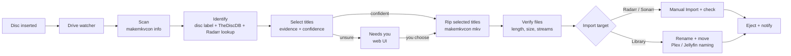
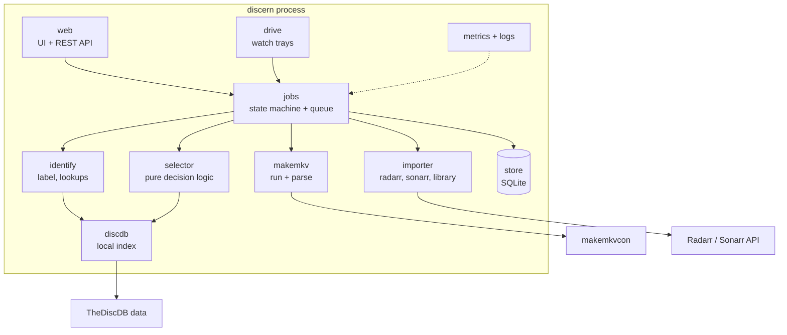
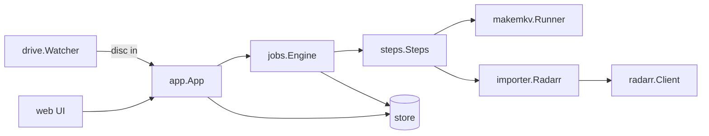
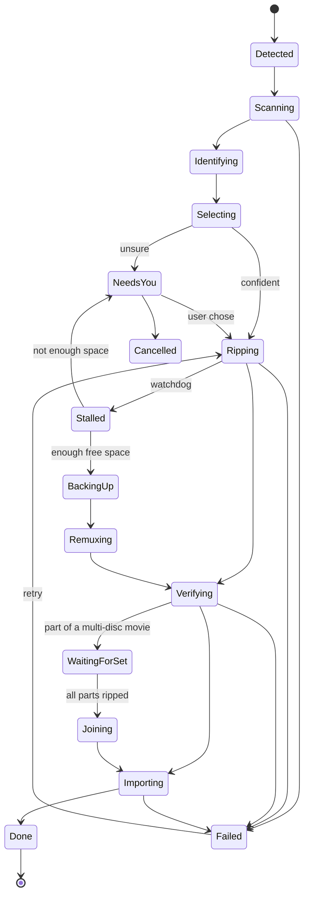

# Discern: design

**Status:** draft, 2026-11-13. Decisions D1–D26 were accepted by the owner on 2026-11-13 and 14, and D27 to D37 on 2026-11-15 and 16. A new decision starts as **Proposed** and becomes **Accepted** once the owner approves it. The decision log (section 17) holds the reasons.

Discern turns a disc in a drive into a correctly named file in your library, with no clicks when it is sure and one question when it is not. It runs MakeMKV, works out which titles on the disc are the movie or the episodes, rips only those, and hands them to Radarr or Sonarr, or files them itself.

---

## 1. Goals and non-goals

**Goals**

1. **Pick the right titles.** Pick the main feature on discs that hide it among hundreds of fake playlists. This is the core of the project, and it is measured (section 8), not claimed.
2. **Be safe when automatic.** Import on its own only when the evidence agrees; otherwise stop and ask. A wrong import costs more than a question.
3. **Work with or without the \*arr stack.** Two import targets, chosen in settings:
   - **Radarr/Sonarr:** import through their own Manual Import, check that it worked, and add missing movies as unmonitored.
   - **Library:** for users without Radarr or Sonarr, Discern renames and moves the files itself, with Plex/Jellyfin naming.
4. **Run like infrastructure.** A small container, a clean shutdown, recovery from a crash, Prometheus metrics, health checks, signed releases.
5. **Stay legally clean to publish.** MakeMKV's proprietary part is never in the repo or the image; each user installs it, accepts its EULA and brings a key. The image holds only MakeMKV's open-source libraries, which its licence lets anyone redistribute (decision D14).

**Non-goals (for v1)**

- Transcoding. Rips stay as remuxes. Tools like Tdarr or Rexarr do encoding.
- Audio CDs, data discs, game discs.
- Windows and macOS hosts. Discern runs in a Linux container.
- Anything that downloads or shares media. Discern only reads discs you put in.
- Writing our own decryption. MakeMKV does that (decision D2).

---

## 2. The big picture



Each box is a step in a **job**. A job is one disc's trip through this flow, and it is saved to a database after every step, so a restart picks up where it stopped (section 6).

---

## 3. Background you need

Short versions of the concepts the rest of the document relies on.

**How a Blu-ray is laid out.** The video sits in **clips** (`BDMV/STREAM/00012.m2ts`). A **playlist** (`BDMV/PLAYLIST/00800.mpls`) says which clips to play in which order. The movie is a playlist. So is each extra, the play-all, and each trailer. MakeMKV calls each playlist a **title**, and the list of clips it uses is its **segment map** (for example `"3,13,15,1"`).

**Fake playlists (obfuscation).** Some studios put hundreds of playlists on a disc. Each one is about the movie's length and uses the same clips in a shuffled order. Only one plays the film correctly; the disc's Java menu (BD-J) knows which. A ripper that picks "the longest title" gets a jumbled film. In TheDiscDB's data the longest title is not the main movie on **192 of 2,627** movie discs (**7.3%**), and the worst have 400–528 titles (*Despicable Me*, *La La Land*, *Toy Story 4*, *Coco*).

**makemkvcon and robot mode.** `makemkvcon` is MakeMKV's command-line engine (closed source). With `-r` it prints one machine-readable line per fact:

```
TCOUNT:42                          how many titles
TINFO:3,9,0,"1:58:12"              title 3, attribute 9 (duration)
TINFO:3,16,0,"00800.mpls"          title 3, attribute 16 (source playlist)
TINFO:3,26,0,"3,13,15,1"           title 3, attribute 26 (segment map)
SINFO:3,1,19,0,"1920x1080"         title 3, stream 1, attribute 19 (resolution)
MSG:5010,0,0,"Failed to open disc" a message with a numeric code
PRGV:120,450,65536                 progress (current, total, max)
```

Attribute numbers come from `apdefs.h` in the open-source `makemkv-oss` package. Discern parses these lines; it never scrapes human-readable text.

**MakeMKV's own main-feature guess.** On fake-playlist discs MakeMKV can run the disc's Java menu and mark the title the menu would play. The output file name then contains `SEG_MainFeature`. It needs a Java runtime in the container, and it is a strong hint, not proof.

**TheDiscDB.** A community, MIT-licensed catalogue of specific disc releases. For each disc it lists every title MakeMKV shows, with its playlist file, segment map, duration and size, and says what each title is (`MainMovie`, `Episode`, `Extra`, ...). It also stores a `ContentHash` per disc. 3,114 movie discs and 255 series are in the dataset today. This lets you identify a disc **by its shape** (which playlists, how long), which is far more reliable than its label.

**Radarr/Sonarr Manual Import.** The API the web UI's "Manual Import" button uses: scan a folder (`GET /api/v3/manualimport?folder=…`), then send a `ManualImport` command naming the movie (or episodes), the quality and `importMode: move`. Radarr then renames and files the file by its own rules. That keeps naming in one place, the user's \*arr settings.

---

## 4. Architecture

One Go program (decision D1), one process, one container. Inside it, packages with one job each:



| Package | Responsibility | Talks to the outside? |
|---|---|---|
| `drive` | Notices discs going in and out, reads the label, ejects. | Linux sysfs and ioctl |
| `makemkv` | Installs MakeMKV, runs `makemkvcon`, parses robot output into Go types, reports progress. | the `makemkvcon` process |
| `discdb` | Keeps a local copy of TheDiscDB's data and an index to look discs up by shape. | git/HTTPS, once a day |
| `identify` | Turns a scan into "which movie or show is this": label clean-up, editions, TheDiscDB, Radarr/Sonarr lookup. | Radarr/Sonarr lookup API |
| `selector` | Decides which titles to rip and how sure it is. **Pure functions: no I/O.** | no |
| `importer` | Radarr, Sonarr and "library" (no \*arr) targets behind one interface. | Radarr/Sonarr API, filesystem |
| `jobs` | The state machine that moves a disc through the steps, one worker per drive. | via the packages above |
| `store` | SQLite: jobs, their history, settings. | the database file |
| `web` | Server-rendered pages and a JSON API on the same data. | HTTP |
| `metrics` | Prometheus counters and histograms, structured logs. | `/metrics` |

**Why these boundaries.**

- **`selector` has no I/O.** Everything it needs (the scan, the TheDiscDB candidates, the library state) is passed in as plain data, and it returns a decision with reasons. That makes the most important logic the easiest to test and to benchmark: run it on 2,627 discs in seconds, no drive needed.
- **`makemkv` is the only package that knows MakeMKV exists.** Everything else sees `Disc` and `Title` structs. If MakeMKV changes its output, one package changes. Tests replace it with a fake that replays recorded output (section 13).
- **`importer` is an interface.** Radarr, Sonarr and Library each implement `Plan(job) → ImportPlan` and `Apply(plan) → Result`. The job logic does not know which one it is talking to, so offering "with or without Radarr" is one setting, not two code paths. Adding another target later does not touch the job logic.
- **One worker per drive.** Each drive gets its own goroutine, so two drives rip at once. They share one MakeMKV install and one database.

**Repository layout** (Go convention: `cmd/` for programs, `internal/` for packages no one else may import):

```
cmd/discern/          the server
cmd/discern-bench/    the title-selection benchmark (section 8)
internal/drive/  internal/makemkv/  internal/discdb/  internal/identify/
internal/selector/  internal/importer/  internal/jobs/  internal/store/
internal/web/  internal/metrics/
testdata/             recorded makemkvcon output, small TheDiscDB samples
deploy/               Dockerfile, compose example, TrueNAS notes
docs/                 this file, ADRs, user guide
```

---

### How v0.1 is wired



- **`cmd/discern`** reads the settings, installs MakeMKV if needed and writes its key (section 9.1), builds the parts and starts them. `discern healthcheck` is the image's health check. On SIGTERM it stops the web server first, so nobody starts new work, then gives running jobs 6 s to reach a safe point. The whole shutdown fits in 8 s, inside the 10 s Docker allows after SIGTERM. A rip stops and resumes at the next start; an import finishes.
- **`internal/app`** is the glue:
  - it starts a job's run when a disc goes in or the user approves or retries;
  - it resumes unfinished jobs at start;
  - it ejects the disc when a job is done;
  - it reports health: the database, makemkvcon and Radarr.
- **`internal/steps`** is the real `jobs.Steps`:
  - **Select** suggests MakeMKV's main-feature title, otherwise the longest. It is never automatic in v0.1.
  - **CheckDisc** first asks the drive watcher whether the tray has changed since the job's scan; the watcher counts every change. If not, the disc can't have been swapped, and nothing is read. Otherwise (a tray change, a restart, or a system where drives can't be watched) it rescans and compares the result with the job's scan. A label alone can't tell discs apart, because generic labels are common.
  - **Rip** rips each chosen title into its own subfolder (the watchdog needs an empty one) and moves the file up into the job's folder.
  - **Verify** checks that there is one file per title, and that each is 70–110% of the size the scan gave it. A rip that stopped early fails here: the Kill Bill stall was under 1%. The bounds are wide until real rips have been measured. With languages chosen (decision D24) the file is smaller by the tracks left out, which the scan's size still counts, so the floor is 30% then. Verify also reads each file's tracks with `mkvmerge -J` (in the image; headers only): it must be a Matroska file with video, and with audio if the title has any on the disc. That is what stops a rip without sound from being imported. It also fails a rip that kept a language's audio but lost that language's lossless track (TrueHD, DTS-HD Master Audio, PCM or FLAC) when the scan's title has one: v0.1.3 kept only Star Trek III's AC-3 copy of its TrueHD 7.1, and Verify passed it. A language with no audio in the file was left out on purpose and isn't checked. Where mkvmerge is missing (a development PC) Discern says so at start and checks size only.
- **`internal/drive`** asks the kernel for the tray state (`CDROM_DRIVE_STATUS`) every 2 s.
  - Only a *change* to "disc ready" starts a job. A disc already in the tray when Discern starts is left alone, because it may be one that was finished before a restart. The UI's Scan disc button starts it.
  - A disc that goes in while the drive still has a job (one waiting for approval, say) is remembered, and the dashboard marks the drive "new disc waiting". It gets its own job as soon as the current one ends (done, failed or cancelled), and it isn't ejected when the old job finishes.
  - On Windows and macOS there is no drive control: the Scan button is the only way to start a job.
- **Running it without hardware.** `cmd/fake-makemkvcon` and `cmd/fake-radarr` stand in for MakeMKV and Radarr. The README shows how to run the whole app with them, and `internal/app`'s end-to-end tests do the same.

## 5. A disc's journey, step by step

1. **Detect.** `drive` checks each tray every 2 s through the kernel (`/sys/block/srN` and the `CDROM_DRIVE_STATUS` ioctl). It deliberately does **not** ask MakeMKV to list drives: that makes MakeMKV query every drive and can disturb a rip in progress (ARM and Rexarr both document this).
2. **Scan.** `makemkvcon -r --cache=1 info dev:/dev/sr0 --minlength=0` gives every title. Discern keeps short titles too, because they help identify the disc by shape.
3. **Identify.** In order of strength:
   1. TheDiscDB `ContentHash`, if one can be computed from the disc (to be confirmed, see open questions).
   2. TheDiscDB **shape match**: a disc whose titles line up with ours by playlist file, segment map, duration (±2 s) and size.
   3. The disc label, cleaned (`SOLO_A_STAR_WARS_STORY` → "Solo a Star Wars Story"), and searched:
      - **Radarr target:** through Radarr's lookup. Radarr proxies TMDb, so users need no separate TMDb key.
      - **Library target:** TheDiscDB's own `tmdb.json` covers the discs it knows. For the rest, Discern searches TMDb directly, which needs the user's free TMDb API key. Without one, unknown discs always go to Needs you.
4. **Select.** `selector` returns the titles to rip, a confidence level and the reasons (section 7).
5. **Decide.** If the confidence is high enough and the auto-import rules pass, continue. Otherwise the job waits in **Needs you** with the evidence shown.
6. **Rip.** `makemkvcon -r --progress=-same mkv dev:/dev/sr0 <title> <staging>` for each chosen title, into a per-job staging folder. Progress goes to the UI and to metrics. The **rip watchdog** watches the process the whole time. If the rip stalls, the job switches to the backup-and-remux strategy (section 9.3).
7. **Verify.** Check each file's duration and size against the scan, and that it has video and the expected audio. A short or empty rip fails here, not after import.

**Finishing is an event, not a silence.** Discern starts `makemkvcon` itself, so it knows when the process exits and with what result. A rip counts as finished only when the process exits successfully **and** the verify step passes. "The file stopped growing" never counts: that rule once announced a stalled 640 MiB rip as finished. Until verified, files stay in staging, where nothing else looks.
8. **Import**, through the target chosen in settings:
   - **Radarr:** look up the movie and add it unmonitored if missing. Scan the staging folder through Manual Import and send the import. Wait for the command, then confirm the movie now has a file of the expected quality.
   - **Library:** build the path from a naming template and move the file there. The default (Plex) is `Movies/Title (Year) {tmdb-123}/Title (Year) {tmdb-123}.mkv`, with `{edition-…}` added for editions. There is a Jellyfin preset as well. Discern then confirms the file is in place with the right size. It refuses to overwrite an existing file, and can optionally ask Plex or Jellyfin to rescan.
9. **Finish.** Eject, notify (webhook or Apprise), clean the staging folder.

**Staging lives on the same filesystem as the library**, so the final move is a rename: instant, atomic (a file is either fully there or not at all), and no double disk space. Discern checks this at startup and warns if it is not true, when `DISCERN_LIBRARY_DIR` tells it where the library is: it compares the two folders' filesystem device ids.

---

### How the Radarr import is built (v0.1)

`internal/radarr` is a small client for the API calls Discern needs. `internal/importer` uses it. The flow keeps the lessons of the pipeline Discern grew out of.

**It refuses before sending anything:**
- a job with no movie;
- an empty staging folder;
- more than one file (v0.1 imports one title per movie);
- a movie Radarr already has a file for (there are no silent replacements);
- a video size it can't name a quality for;
- a folder outside the staging mapping.

**Then it imports:**
1. Ask Radarr to scan the job's staging folder, and use Radarr's own entry for the file. That way the path and languages are what Radarr itself read. This comes first, so a wrong path mapping fails before anything is added to the library.
2. If a Manual Import for this file is already running (a retry after a timeout), wait for that one instead of starting a second.
3. Otherwise, add the movie if it is missing. It is always added unmonitored, with no search, so Discern never makes Radarr download anything. That rule is in the client itself: a caller can't turn it on.
4. Set the movie and the quality on the entry. The quality object is Radarr's own, from its quality definitions, never built by hand. It goes in wrapped as Radarr's `QualityModel`, `{"quality": …, "revision": …}`, keeping the revision from Radarr's own scan entry. Sent bare, Radarr 6.4.4 files the movie as "Unknown": the first real import did exactly that (2026-11-13), and the fake Radarr, which had copied Discern's mistake, now follows Radarr's published API definition. The release group is cleared, since Radarr would otherwise read one from the staging folder's name. The grade is the higher of what the video's width and height say: a scope film stored as 1920x800 and an anamorphic 1440x1080 Blu-ray are both `Remux-1080p`. The entry also gets the file's audio languages (decision D27): read from the file itself with `mkvmerge -J`, the same read Verify made a moment before, and matched by name to Radarr's own list (`GET /api/v3/language`). Radarr can't tell them from a rip's name and files as "Unknown" otherwise. They are read before the movie is added, like the scan, so a failed read leaves nothing behind in Radarr. A language Radarr doesn't list is left out and logged. The names were checked against Radarr 6.4.4's own `Language.cs`: all but Malay are there, and Discern can name thirteen more languages than the Settings page offers, so a file's list is whole.
5. Send a Manual Import with `importMode: move`.
6. Wait for *that* command's ID, not Radarr's whole queue. A few failed status checks in a row (Radarr restarting) are tolerated, because the command keeps running in Radarr regardless.

**It verifies the import happened.** Radarr has to say the movie has a file of the expected quality, *and* the file has to have left staging.

**Path mapping.** Discern and Radarr usually mount the same storage at different places. `PathMap` translates the staging folder, and refuses anything outside it, so it doubles as the guard on what Radarr is asked to import.

**Safe to rerun.** An empty staging folder plus a movie whose file Radarr added *after the job started* means the import already happened, before a crash or a failed check. `Import` sends nothing then, but still checks the file: a Retry can't call an import filed as Unknown done. Any known quality passes, because the user may have set a different one in Radarr on purpose. Discern doesn't correct a wrong quality itself: the job's error says to set it under Manage Files in Radarr and retry. If the movie's file is older than the job, it's the user's earlier copy: the rip has gone missing, and that is an error, not a success.

**Identify.** `internal/identify` cleans the disc label:
- `SOLO_A_STAR_WARS_STORY` becomes "Solo A Star Wars Story";
- disc words (`UHD`, `D1`, `Disc 1`) are dropped;
- a trailing `THE` moves to the front;
- an edition is set apart, but only at the end of the label, after the title ("Watchmen- Ultimate Cut"). Edition words elsewhere are part of the title: `UNCUT_GEMS`, `THE_FINAL_CUT`;
- a year counts only in brackets ("Spider-Man 3 (2007)"). A bare number is part of the title: `BLADE_RUNNER_2049`, `1917`;
- a generic label (`DVD_VIDEO`, `BD_ROM`, `VIDEO_TS`, `LOGICAL_VOLUME_ID`) gives no search term at all.

MakeMKV's disc name is searched first, then the volume label if the name finds no movie. The name is the studio's full title from the disc's metadata; the volume label is often abbreviated. On the first homelab discs `STAR_TREK_I_TMP` and `STAR_TREK_II_TWOK` found nothing, while the names "Star Trek I: The Motion Picture" and "Star Trek II: The Wrath of Khan" found the films (v0.1.2; the label used to go first). A name and label that clean to the same term are searched once. Radarr's TMDb lookup does the search. A result counts only if its title shares a meaningful word with the term (`identify.TitleFits`): Radarr's top hit can be a fuzzy match, and the old homelab pipeline once imported a rip as the wrong film. A year in either label picks among results. Bonus discs' names ("Special Features", "Bonus Disc") and terms over 100 characters say nothing, so they aren't searched; disc names are untrusted. A failed search doesn't stop the other term from being tried. A raw label is never searched, since a generic one would match a random film. No match, or no usable label, is not an error: the user picks the movie in Needs you.

**API key.** It is sent in the `X-Api-Key` header, never in a URL, so it can't end up in a log line or an error message.

## 6. Jobs, state and recovery



- **Every transition is written to SQLite before the next step starts.** The database is the source of truth, not memory.
- **On restart**, each unfinished job is resumed by its state:
  - `Ripping`: the partial file is deleted and the rip starts again. A half-written rip is never trusted.
  - `BackingUp`: the partial backup folder is deleted and the backup starts again.
  - `Remuxing`: the partial MKV is deleted and the remux runs again from the backup, which is complete at this point.
  - `WaitingForSet`: stays waiting, with the finished parts kept in staging.
  - `Importing`: ask Radarr first whether the movie already has the file. Import steps are **idempotent**: running one twice does no harm, because each checks before acting.
  - `NeedsYou`: stays waiting.
- **Clean shutdown.** On `SIGTERM` (what `docker stop` sends), stop taking new discs, let a running import finish, and stop a running rip cleanly. The job is then resumed at the next start. The whole shutdown fits in 8 s (2 s for the web server, 6 s for jobs), inside the 10 s Docker allows after SIGTERM before it kills the container. A job still running then is safe to cut off: its state is saved, an interrupted rip starts again, and an interrupted import is picked up by the next start (the importer recognises a finished import, and joins one still running in Radarr).
- **One job per drive at a time.** A second disc in the same drive is only seen after the first job leaves the drive. The database enforces this too: a partial unique index on `jobs(drive)` covers only active states, so no bug in Go code can start two jobs on one drive.

### How it is built (v0.1)

- **The state machine is a table.** `internal/jobs/state.go` lists, for each state, the states it may move to. The engine refuses any other move. v0.1 has the states up to `Done`, `Failed` and `Cancelled`; the recovery states (`Stalled`, `BackingUp`, …) are added with the fallback in v0.2.
- **Every step is safe to run again,** so recovery needs no special code. After a restart, the engine runs the step that the saved state names:
  - Scan, identify, select and verify only read.
  - Ripping always starts by emptying the job's staging folder.
  - Import must check before it acts.
- **The disc is checked before every rip.** The user may have swapped discs while the job waited for approval, or while Discern was stopped. `Steps.CheckDisc` compares the drive's disc with the job's scan. On a mismatch, the job fails, and a retry starts over with a fresh scan.
- **Cancel and Run exclude each other.** Cancel takes the job's run slot while it works, so a Run starting at the same moment gets `ErrRunning` instead of starting a rip on a job that is being cancelled.
- **Progress has one writer.** Only `SetProgress` writes it. `Move` saves the fields the engine owns and leaves progress alone, so saving an older copy of a job can't wipe out how far the rip got.
- **Saving is compare-and-swap.** `Store.Move` updates the row only `WHERE id = ? AND state = ?` (the state the engine last read), and records the history event in the same transaction. A stale copy of a job can never overwrite a newer state.
- **Interrupted is not failed.** If a step stops because Discern is shutting down or the user cancelled, the job stays in its state and resumes later. Only a step's own error moves it to `Failed`. Retry resumes at the step that failed: `Ripping`, `Verifying` or `Importing`. A failed scan, identify or select starts again from `Detected`.
- **An import that has started finishes.** `Importing` can't be cancelled, and the import step runs on a context that ignores cancellation (the importer has its own timeouts). This keeps Radarr and Discern agreeing about where the file is.
- **Dependency direction.** The engine defines the `Store` interface it needs, and `internal/store` implements it with SQLite. The engine never sees SQL, and its tests run against the real store in a temporary file.
- **SQLite details.** Pure-Go driver (`modernc.org/sqlite`), WAL journal and one connection: SQLite allows one writer at a time anyway, and a single connection rules out lock errors between Discern's own goroutines. Migrations are embedded SQL files, counted with `PRAGMA user_version`, each applied in its own transaction. Tables are `STRICT`, and times are Unix milliseconds in UTC.

### Movies split across discs

Some releases split one movie over two discs (for example a UHD "Whole Bloody Affair" edition, disc 1 and disc 2). Radarr holds **one file per movie**, so importing disc 1 alone would make disc 2 look like a replacement. TheDiscDB shows such a release as one movie with its parts on several discs.

1. After disc 1 is verified, its job waits in `WaitingForSet`, labelled "part 1 of 2". Nothing is imported. The UI asks for the next disc, and the drive is free for it.
2. When the last part is verified, Discern checks that the parts' tracks line up one-to-one: same number, order, codecs and languages. If they don't, the job goes to **Needs you** with the difference shown.
3. `mkvmerge` joins the parts with its append option (`part1.mkv + part2.mkv`). Chapters continue across the join.
4. Verify checks the joined file's length against the sum of the parts, then the job imports one file.

---

## 7. Title selection

This is the part that makes Discern worth using. The selector collects **evidence**, each piece with a weight. Then it either agrees on a choice or abstains.

**Evidence, strongest first:**

| Evidence | Why it is strong or weak |
|---|---|
| TheDiscDB names a title `MainMovie` on a disc that matches ours by shape | Someone ripped this exact pressing and checked it. Matching by playlist file and segment map survives MakeMKV numbering titles differently, a real problem seen in practice. |
| MakeMKV marks a title as the main feature (`SEG_MainFeature`) | It ran the disc's own menu logic. Usually right on fake-playlist discs, but it can fail or be missing. |
| Only one title is feature-length | On a normal disc this is the movie. |
| Longest title, then most chapters | The fallback. Right 92.7% of the time, which is not enough to act on alone. |

**Checks that remove decoys:**

- **Too little data.** A long playlist under ~3 Mbit/s loops tiny clips. It is never the film.
- **Lookalikes.** Several titles within a few minutes of each other that use the same clips in a different order mean a fake-playlist disc. The longest-title rule is then switched off.
- **Duplicates.** Same duration (±0.5 s) and size (±0.1 %) means the same video through another playlist. Keep one.
- **Play-all.** A title whose segment map is the others joined together. Not an episode, not the movie.

**Output:**

```go
type Decision struct {
    Titles     []int        // which titles to rip
    Kind       Kind         // Movie, Episodes, Unknown
    Confidence Confidence   // High, Medium, Low
    Reasons    []string     // human-readable, shown in the UI
    Holds      []string     // why it will not act alone, empty if it may
}
```

**Auto-import rules (holds).** The job continues on its own only when **all** of these are true. This is the confidence gate:

- A TheDiscDB shape match exists, and the movie it names agrees with the disc label and with Radarr's first lookup result.
- Exactly one candidate main feature remains after the decoy checks.
- No second title of 45 minutes or more is unaccounted for (could be another cut).
- The edition in the disc name (Extended, Director's Cut, ...) agrees with TheDiscDB.
- The movie is not already in the library at the same or better quality (no silent replacements).

Anything that fails a rule goes to **Needs you** with the reason, and the UI pre-fills its best guess. Auto-import starts **off** in a fresh install; a `trial` mode logs "would have imported" without doing it, so a user can build trust first.

---

## 8. Measuring it: the benchmark

`cmd/discern-bench` runs the selector over TheDiscDB's movie discs and scores it. Each disc's record has the full title list as MakeMKV showed it, plus the answer (which title is `MainMovie`). That makes it a ready-made test set of about 2,600 discs with one main movie each.

**The trap: testing on the answer key.** The selector *uses* TheDiscDB, so a naive benchmark would look up each disc and find its own answer: 100%, and meaningless. The benchmark therefore runs **leave-one-out**: for each disc, it hides that disc's whole release from the index before asking the selector. That measures what happens with a disc TheDiscDB does not know, which is the case that matters. A second run with the index intact measures the "known disc" path.

**Scores:**

| Outcome | Meaning | Cost |
|---|---|---|
| Correct | picked the `MainMovie` | none |
| Abstained | said "needs you" | one question for the user |
| Wrong | picked another title, confidently | a bad file in the library: the outcome to minimise |

The target is about precision, not coverage: **under 0.5% wrong among the discs it acts on alone**, with as few abstentions as that allows. The baseline to beat is "longest title": 92.7% correct, 7.3% wrong, 0% abstained.

The benchmark runs in CI, and a pull request that makes "wrong" go up fails. That is a **regression gate**: the number in the README stays true.

---

## 9. Running MakeMKV and keeping rips healthy

### 9.1 Install, key and process rules

- **Two parts, installed in two places** (decisions D6 and D14). MakeMKV for Linux comes as two tarballs:

  | Tarball | What it is | Licence | Where it goes |
  |---|---|---|---|
  | `makemkv-oss` | the libraries `makemkvcon` loads (`libmakemkv`, `libdriveio`) and two helpers, as source | LGPL or GPL, per file | compiled into the **image** at build time |
  | `makemkv-bin` | `makemkvcon` itself, prebuilt for amd64, arm64 and others, plus its data files and `blues.jar` | MakeMKV's EULA | downloaded at **first start**, into `/config/makemkv/<version>` |

- **The installer** (`internal/makemkv/install`) runs at every start, before the web server:
  - It does nothing unless `MAKEMKV_ACCEPT_EULA=yes`. Discern then stops with a message pointing to the EULA. Withdrawing the acceptance stops Discern using an existing install too.
  - If `/config/makemkv/<version>/installed.json` matches the pinned release and this CPU, it is done: a no-op.
  - Otherwise it downloads `makemkv-bin-<version>.tar.gz` (19 MB for 2.0.0) and compares its SHA-256 with the pin. The tarball is opened only after that check passes: verify before parse.
  - It copies out five files by exact name (`bin/<arch>/makemkvcon`, the three data files, the EULA), laid out as MakeMKV's own `make install` does. `makemkvcon` finds its data in `../share/MakeMKV`, relative to itself.
  - It builds everything in a temporary folder and renames it into place, so an install is either complete or absent. The marker is written last. Leftovers of an interrupted install, and older versions, are removed.
  - Setting `DISCERN_MAKEMKVCON` turns the installer off and uses that program instead. This is for the fake `makemkvcon` in development.
- **Why the pinned hash is enough** (decision D15). MakeMKV signs a checksum file for each release (`makemkv-sha-<version>.txt`, clearsigned with GPG). The signature is checked when the pin is set, not at every install:
  - `scripts/update-makemkv-pin.sh` verifies the signature with `gpgv` against the pinned key, then writes the two hashes into `pin.env` and saves the signed file next to it.
  - It reads the hashes from `gpgv --output`, which contains only the signed text. Text added in front of the signed block still gets "Good signature" from gpgv, so a script that read the whole file could be fooled.
  - `TestPinMatchesSignedFile` repeats the check on every CI run: the signed file verifies with the pinned key, and `pin.env` holds exactly its hashes.
  - At install time, the hash pinned in the binary is stronger than the signature. It accepts only the exact file that was tested, not any file MakeMKV ever signed. This is how `go.sum` works: verify once when the pin is added, then compare hashes.
- **The pinned key.** MakeMKV doesn't publish its key's fingerprint, so trust comes from cross-checks, done on 2026-11-13:
  - `MakeMKV (signature) <support@makemkv.com>`, DSA 2048, created 2017-05-26, fingerprint `2ECF 2330 5F1F C0B3 2001 6733 94E3 083A 1804 2697`;
  - the same key from keyserver.ubuntu.com and keys.openpgp.org;
  - it signed both 2.0.0 (2026-09-21) and 1.18.4 (2026-06-15).
- **Version and updates** (decision D16). The pin is 2.0.0. A weekly workflow (`makemkv-update.yml`) runs the pin script and opens a pull request when a new release is out. A new Discern release then ships it, and the installer swaps versions at the next start. Old MakeMKV versions stop working after a while, so the pin can't be left alone for long.
- **Key.** `MAKEMKV_KEY` (or `MAKEMKV_KEY_FILE`) is written into MakeMKV's `settings.conf` as `app_Key` at every start. Other settings are kept, and an unchanged key writes nothing. The file is in `$HOME/.MakeMKV`, and the image sets `HOME=/config`. Keys with quotes, backslashes, spaces or control characters are refused, so a key can't break out of its quoted value. A settings page and a dashboard error for a missing or expired key come later.
- **Languages** (decisions D20, D24). Before each rip, Discern writes MakeMKV's track selection rule into `settings.conf` as `app_DefaultSelectionString`, built from the Settings page by `makemkv.SelectionRule`: video always; audio in the chosen languages, plus audio with no language or a title's only audio track; subtitles in the chosen languages (forced only, if set); commentary dropped unless kept; and 3D video dropped (`-sel:mvcvideo`), as MakeMKV's default does. Every audio track in a chosen language is kept (decision D28): a lossless track and its lossy copy, and a stereo track beside a surround one. v0.1.3 also had `-sel:(havemulti|havecore)`, copied from MakeMKV's `default.mmcp.xml`; MakeMKV ignores that file's selection, and its built-in default (`-sel:all,+sel:(favlang|nolang),-sel:mvcvideo,=100:all,-10:favlang`) has no such clause. With it, the first real rip with languages (Star Trek III, UHD) lost its TrueHD 7.1 track and kept only the AC-3 5.1 copy. With no languages saved, Discern removes its rule, so MakeMKV's default applies. A chosen title with no audio in those languages (a foreign film) keeps its own audio as well, for that rip only: its languages are added after the user's, and it is logged. The per-disc choice on the redesigned review page will replace that. The first audio language is the one the Settings page calls preferred; its track comes first. A per-rip `--profile` can't carry the rule: MakeMKV 2.0.0's `default.mmcp.xml` says the profile's selection tag is ignored since 1.12.4. Each language's weight is lowered by one step per rank, so weights stay positive however many are chosen. Checked on a real rip (v0.1.3, 2026-11-15): `makemkvcon` honours the rule from `settings.conf`; only English tracks were kept. Not yet checked: that lower weights come first, and what `nolang` and `single` match exactly (MakeMKV doesn't document them). Verify's track check is the safety net for both. **Two forms of the codes.** ISO 639-2 gives some languages two codes, and both turn up for one disc: a real UHD scan said `deu`, `fra`, `nld` (the /T form), while the Matroska file MakeMKV wrote says `ger`, `fre`, `dut` (/B). MakeMKV's rule accepts either, but Discern's own comparisons go through `lang.Canonical` (`internal/lang`), which gives the /B form. v0.1.3 compared them as text, so for French, German, Dutch and seventeen other languages every title looked foreign and nothing was trimmed. `und` (undetermined) counts as no language, as an empty code does: the rule's `nolang` keeps those tracks, and `und` never goes into the rule. The codes ISO 639-2 withdrew in 2008 (`scc`, `scr`, `mol`) are read as their replacements (`srp`, `hrv`, `rum`), for discs pressed before then. A code from the disc that isn't three letters is left out of the rule, not passed on: one odd code must not fail the rip.
- **Java** (decision D17). The image includes Debian's headless Java. `makemkv-bin` ships `blues.jar`, MakeMKV's runner for a disc's Java menu (BD-J), so Java does get used. Without it, the `SEG_MainFeature` evidence is missing on exactly the discs that need it. How much it adds to the image, and how often it matters, is still to measure (section 19).
- **Process rules.** One `makemkvcon` per drive. No drive listing while any rip runs. Each process gets a timeout, and output is read line by line as it streams, never buffered whole.
- **Errors by code.** Failures are recognised by MakeMKV's numeric `MSG` codes and turned into specific errors ("disc unreadable", "key expired", "drive not supported").
- **Incomplete scans fail closed.** MakeMKV can log read errors (`MSG 2003`) and skipped titles (`3016`, `5043`), then report "Operation successfully completed" and exit 0. On the first real run a UHD scan made while the drive was still spinning up had 1,204 read errors and 35 skipped titles, and its titles no longer matched a clean scan of the same disc. Two things now prevent that. Before every scan, Discern waits for the kernel to report the drive ready (`drive.WaitReady`: `CDROM_DRIVE_STATUS` polled each second for up to 2 minutes; a tray that is open or empty fails at once). And a skipped title, or a read error that says the drive was `NOT READY`, makes the scan an error (`makemkv.IncompleteScanError`). Other read errors alone don't: copy-protected DVDs (ARccOS, RipGuard) carry deliberately unreadable sectors that MakeMKV reads around on every scan, and a title it really can't read is reported as skipped. Scan and CheckDisc try an incomplete scan again after 30 s, up to 3 scans in all. If every attempt is incomplete, the job fails with the counts and MakeMKV's first message. A scratched disc with one unreadable extra therefore can't be ripped yet; an override is for later.

### 9.2 The rip watchdog

MakeMKV does not always fail loudly. A known case: MakeMKV 2.0.0 on a UHD disc whose video has a two-layer Dolby Vision stream (profile 7). The drive kept reading at about 17 MB/s, but the output file stopped at 640 MiB and never grew again. MakeMKV raised no error and estimated 40 hours left. Its debug log showed why: its 256 MiB read cache was full, waiting for main video and audio while only the Dolby Vision layer kept arriving.

Discern knows the process ID of every `makemkvcon` it starts. Every 10 s the watchdog compares two counters:

- **Bytes read** by the process, from `/proc/<pid>/io` (`rchar`: every byte its `read()` calls returned). During the real stall `rchar` and `read_bytes` both showed 17.2 MB/s. `rchar` also counts reads served from the page cache, which the fake makemkvcon relies on.
- Where there is no `/proc` (a Windows or macOS development machine), read counts are unknown. The watchdog then can't tell a stall from a hang, and only the hang rule applies, judged on output alone.
- **Bytes written**: the output file's size.

| Reading rises | Output grows | Verdict |
|---|---|---|
| yes | yes | healthy |
| yes | no, for 120 s | **stalled**: data comes in, nothing comes out |
| no | no, for 10 min | **hung**: nothing moves at all |

The thresholds are settings. Defaults are loose enough for a slow drive and the pause at the start of a rip.

On a verdict, the watchdog does three things:

1. **Saves the evidence:** MakeMKV's own debug log, the robot output so far and the counter samples, into the job's diagnostics bundle (`/config/diagnostics/job-<id>-<time>/`; the failure page offers it as a .zip, decision D37; written since v0.1.7, though v0.1 planned it). MakeMKV's key is removed from it first. Retry and Cancel keep the job's link to it; at each start, bundles no listed job refers to are removed. The debug log is a temporary file MakeMKV has already deleted but still holds open, so it is copied from `/proc/<pid>/fd/<n>` **before** the process is stopped. Once the process stops, it is gone. The bundle is what MakeMKV's forum asks for in a bug report.
2. **Stops the process**: `SIGTERM`, then `SIGKILL` after 10 s.
3. **Hands the job on:** stalled → the fallback strategy; hung → `Failed` with the reason.

### 9.3 Rip strategies and the fallback

A **rip strategy** is how a chosen title gets from disc to MKV. The job logic asks for a strategy and does not know how each one works, the same idea as the `importer` interface.

| Strategy | Steps | Cost |
|---|---|---|
| **Direct** (default) | `makemkvcon mkv` straight to an MKV | one pass, about the disc's size in space |
| **Backup + remux** | `makemkvcon backup --decrypt` copies the disc as it is; then `mkvmerge` builds the MKV from the chosen title's playlist (`BDMV/PLAYLIST/00001.mpls`), which keeps the chapters and both Dolby Vision layers | about twice the time and twice the space while it runs |

The second route skips MakeMKV's muxer entirely. Opening the backup in MakeMKV is not used: in the same case, MakeMKV crashed when opening its own backup.

- **When it is used:**
  - **Automatically:** when the watchdog reports a stall, if free space in staging is at least twice the title's size plus a margin. With less, the job goes to **Needs you** and says how much space is missing.
  - **Up front:** when the strategy history says the direct route already failed on this disc, or on discs of the same kind. That skips a wasted attempt.
- **Strategy history.** Each attempt is stored in SQLite: disc fingerprint (TheDiscDB `ContentHash` or a hash of the title shapes), MakeMKV version, strategy, result. A newer MakeMKV version resets the "known bad" mark, so Discern tries Direct again after an upgrade.
- **Clean-up.** The backup folder is deleted after the remuxed file is verified. It sits in staging, never in the library.

---

## 10. Data and configuration

- **SQLite** in `/config/discern.db` (decision D3): jobs, per-job events, settings. Using the pure-Go driver keeps the binary free of C dependencies.
- **Config precedence:** defaults < `/config/discern.yaml` < environment variables. Environment variables win so a container can be configured entirely from compose.
  - **v0.1 reads environment variables only** (`internal/config`): every setting is a `DISCERN_*` variable, and secrets can come from a file through `NAME_FILE`. All problems are reported at once, so a fresh install can be fixed in one pass. The YAML file comes later, if a setting turns out to need it.
  - **The Settings page** (decisions D21, D24–D26, from v0.1.3) holds what can change while Discern runs: eject when done, and the languages to keep. It is stored in SQLite as one key-value table (`settings`: key, JSON value), read as one typed struct (`internal/settings`); a setting with no row has its default, and a value that doesn't parse is an error, not a default. `DISCERN_EJECT` is gone; if it is still set, its value becomes the page's starting value once (only while eject was never saved), and Discern logs that the variable is no longer used. If the saved settings can't be read, rips fail closed, but the page still opens with the defaults and the reason, and saving it replaces them.
- **Secrets** (API keys, MakeMKV key) come from env vars or, better, `*_FILE` variables pointing at Docker secrets. They are never logged or shown in the UI after saving.
- **MakeMKV's own settings** keep MakeMKV's names, as other MakeMKV images use them: `MAKEMKV_ACCEPT_EULA` (only `yes` accepts; any other value set is an error, not a guess) and `MAKEMKV_KEY` / `MAKEMKV_KEY_FILE`. `DISCERN_MAKEMKV_DIR` (default `/config/makemkv`) is where MakeMKV is installed.
- **Volumes:** `/config` (database, MakeMKV, TheDiscDB copy) and the media path (staging and library on the same filesystem).

---

## 11. Interfaces

- **Web UI:** server-rendered HTML (Go's `html/template`) with htmx for live parts such as progress bars and the queue (decision D4). There is no JavaScript build step, and the whole UI ships inside the Go binary with `embed`. Messages that describe the page are worded in the web layer: the engine returns `jobs.ErrNoMovie`, and the job page says where to type the TMDb id.
  - **Pages:** Dashboard (each drive with its job or its tray's state, and the recent jobs), the job page (review, ripping and result), Settings. Since the first redesign part (2026-11-15) a job is named by its movie or disc and shown with its poster; the URL keeps the internal id, which no page shows.
  - **Redesign (planned after the first homelab run, 2026-11-13).** The owner's requirements from that run:
    - **Mobile-first.** Approving a disc from a phone must work well: stacked cards, large touch targets, the decision on one screen.
    - **No job numbers.** A job is named by its movie (or the disc's name until the movie is known) and when it started. Whole cards are links; the URL keeps an internal id that the UI never shows.
    - **Clear drive and disc states:** tray open, empty, disc loading, reading, ripping, done.
    - **Elapsed time and time left** for scans and rips. MakeMKV's progress lines are there for both.
    - **Posters as the visual anchor of a job** (decision D23).
    - **A calmer title list:** the suggested title and its reason up front; extras and short clips folded away and grouped.
    - **Audio and subtitle languages** chosen per job, with a global default (decisions D20, D21).
    - **Eject when done** as a Settings page option (added 2026-11-14; decision D25 removes `DISCERN_EJECT`). The owner wants the tray left shut. On the homelab drive (USB, JMicron bridge) the eject call reported success but the tray didn't open; unexplained so far.
    - **Failures in plain words,** with MakeMKV's own messages folded underneath (decisions D35-D37). Each failure is saved with a short kind (disc changed, scan incomplete, rip stalled or hung, MakeMKV error, file too small, no audio, lossless track lost, Radarr refused, or the step's own name), and the page turns the kind into a sentence and what to do. The technical reason, up to 50 of MakeMKV's messages (the known errors first, then the last lines, in order; known error codes marked) and, after a stall or hang, the diagnostics bundle as a .zip download are folded under it. The dashboard's recent list shows the plain sentence.
    - **Pick the cut** when a disc holds more than one (added 2026-11-14). The Wrath of Khan UHD has the Director's Edition (title 14, `00801.mpls`, 1:56:31) and the theatrical cut (title 30, `00800.mpls`, 1:53:03): two long titles within a few minutes of each other that share most of their segments. Today Discern just suggests the longer one. Instead it should show the cuts side by side, named where it can tell (TheDiscDB's data, or the length matched to known runtimes), let the user choose, and record the choice as the edition in Radarr (`{edition-…}` naming). It brings forward part of the v0.4 editions work; a global "prefer the theatrical / extended cut" default could follow.
    - **Say what each title is** (added 2026-11-14), so the user can choose extras to import as well: main feature, other cut, deleted scenes, featurettes, trailers, a "play all" of other titles, menu clips and duplicates. Names come from TheDiscDB where the disc is known (decision D5; its data names titles per disc). Otherwise Discern labels what the scan shows (length, segment maps, duplicates, play-all), and says it is a guess. Where chosen extras go is a design question still to settle: Radarr manages only the movie file, so extras would go into the movie's folder with Plex/Jellyfin extras naming (`Featurettes/`, `-deleted`), which the Library target (D9) already has to know.
    - ~~Grey out the language choices~~ on the Settings page while "MakeMKV's default selection" is on: done in v0.1.4. A small script file of Discern's own, `static/toggle.js` (since v0.1.6 shared with the review page's language panel), disables the whole group, for the mouse, the keyboard and screen readers, and disabled controls aren't sent. It is a file, not inline, so the Content-Security-Policy is unchanged; there is still no build step (D4). If the script doesn't run, CSS dims the group and the server ignores it.
    - **A standard login page** instead of the browser's Basic-authentication popup (added 2026-11-14; section 15 planned it). It needs its own decisions before it is built: how sessions are kept, how long a login lasts, logout, cookie flags on plain HTTP, and what the API uses instead of Basic.
  - **Build order** (chosen 2026-11-15): the dashboard and the ripping page first (job cards named by movie, posters, drive states, elapsed time and time left, read and write speeds, the watchdog's state), then the review page (the calmer title list, per-job languages, the cut picker and title labels once their designs are settled), then the failure page, then the login page.
  - **Time left** (decision D29) is worked out from the progress so far: the time since makemkvcon started copying (not since the disc check before it, which can take minutes; a rip of several titles counts from the first), divided by the share done, times the share left. MakeMKV's progress is by bytes, so it moves steadily. Until a minute has passed and 2% is done, the page says "estimating". A scan shows only its elapsed time: its progress jumps from title to title.
  - **Read and write speeds** (decision D30) come from the watchdog's samples, averaged over the last minute, and are kept in memory with the watchdog's verdict. A restart loses them, which costs nothing: the rip starts again after a restart anyway.
  - **Posters** (decisions D23, D31) are fetched in the background once a job's movie is known (after identification, when the user sets the movie, and at start for active and recent jobs), and stored in `/config/posters` as `<tmdb id>.jpg` or `.png`. Only `https://image.tmdb.org` URLs are fetched, at the 342-pixel width; the answer must be a JPEG or PNG under 2 MB. A failed fetch leaves the job without a poster, never failing the job, and is tried again an hour later when a page shows that job (and at the next start). At each start, posters no listed job uses (search results nobody picked, jobs too old for the dashboard) are removed; a job's page fetches its own again if needed. The browser loads them from Discern (`/posters/<tmdb id>`), so the Content-Security-Policy stays `'self'`.
  - **The review page** (decisions D32-D34) puts the suggested title first, with its reason. The disc's other titles are grouped by length against it (D32): "possible other cuts" (75% of its length or more) are shown open, "extras" (2 minutes up to that) and "short clips" (under 2 minutes) are folded with their counts, and every title stays tickable. A wrong movie is found by name (D33): Discern asks Radarr's lookup and lists the matches with year and poster; tapping one shows it on the page, and it is saved only when the rip is approved. A TMDb id can still be typed, folded away. A search or pick sent from another website is ignored, since it makes Discern ask Radarr and save posters. This disc's languages (D34) are summarised from the Settings page; "Choose languages for this disc" offers the disc's languages (every title's, the chosen ones' first, since the choice applies to whichever titles are ticked), and the choice is saved with the job and used for its rip instead of Settings (and of the foreign-film fallback, which it replaces). A refused approval comes back as the user left it, and a disc's saved choice is shown again after a Retry.
  - It stays server-rendered with htmx (D4), and nothing is inline (the Content-Security-Policy).
- **REST API:** `/api/v1/...` over the same data, with an API key, for scripts and for Homarr-style dashboard widgets.
- **Events out:** a webhook on job changes, and Apprise support, so Discord, ntfy and others work without Discern knowing each one.
- **Health:**
  - `/healthz` answers "the process is alive".
  - `/readyz` answers "MakeMKV is installed, the database is open and the targets answer".

---

## 12. Observability

**Metrics** (Prometheus format at `/metrics`):

| Metric | Type | Question it answers |
|---|---|---|
| `discern_jobs_total{result}` | counter | How many discs went through, and how many failed? |
| `discern_step_duration_seconds{step}` | histogram | Where does the time go: scan, rip, import? |
| `discern_rip_bytes_total` | counter | Throughput, drive health over time. |
| `discern_selection_total{confidence,auto}` | counter | How often does it act alone vs ask? |
| `discern_makemkv_errors_total{code}` | counter | Which MakeMKV failures are common? |
| `discern_rip_read_bytes_per_second{drive}`, `discern_rip_write_bytes_per_second{drive}` | gauge | Is the rip healthy right now? The gap between the two is the stall signal; alert on it. |
| `discern_rip_stalls_total{verdict}` | counter | How often does MakeMKV stall or hang? |
| `discern_rip_strategy_total{strategy,result}` | counter | How often is the fallback needed, and does it work? |
| `discern_drive_state{drive}` | gauge | Empty, loaded, busy. |

**Logs:** structured JSON through Go's `log/slog`, one field set per job (`job_id`, `drive`, `step`), so one disc's story can be filtered out of the log.

**Dashboard:** a Grafana dashboard JSON shipped in `deploy/`, built on the metrics above.

---

## 13. Testing strategy

| Layer | What | How |
|---|---|---|
| Parser | robot-mode lines into structs | table tests over recorded output in `testdata/` |
| Selector | decisions on real disc shapes | unit tests, plus the benchmark (section 8) |
| MakeMKV runner | process handling, timeouts, progress | a fake `makemkvcon` (`internal/makemkv/fake`) that replays a recorded scan and writes rips at a set pace, or stalls or freezes on cue. The test binary plays the fake itself: `TestMain` hands over to it when `FAKE_MAKEMKVCON` is set, so the tests need no separate build. `cmd/fake-makemkvcon` is the same fake as a standalone binary for manual runs |
| Importer | Radarr/Sonarr calls | `httptest` servers that answer like Radarr, from recorded responses |
| Jobs | state machine and crash recovery | run a job, kill it at each state, restart, check it resumes correctly |
| Watchdog | stall and hang detection, evidence capture | the fake `makemkvcon` replays a recorded stall: it keeps reading but stops writing at 640 MiB. The test checks the verdict, the bundle and the switch to Backup + remux |
| Disc sets | waiting, track check, join | two small recorded parts with matching tracks, and a pair that does not match |
| End-to-end | the whole flow without hardware | fake drive + fake makemkvcon + fake Radarr in one test |

Recordings come from real discs. When a disc behaves oddly in real use, its scan is saved as a new test case, so every bug becomes a test.

---

## 14. Packaging and delivery

- **Image:** the `Dockerfile` has three stages (decision D17):
  1. **build:** compiles Discern. It runs on the build machine's own CPU (`--platform=$BUILDPLATFORM`) and cross-compiles with `GOARCH`, so an arm64 image doesn't compile Go under emulation.
  2. **makemkv-oss:** downloads the pinned `makemkv-oss` tarball, checks its SHA-256 against `pin.env`, and builds it without the GUI (`./configure --prefix=/usr --disable-gui`). It keeps MakeMKV's `License.txt` and a note of the source URL and hash.
  3. **final:** Debian 13 slim. It holds Discern, the oss libraries, the libraries those link against, MKVToolNix and `default-jre-headless`. An `ldd` check fails the build if any library is missing.
  - **Base images are pinned by tag and digest,** so a rebuild uses the same bytes until the pin is changed on purpose.
  - **A health check** runs `discern healthcheck`, which asks the running server's `/healthz`. The image has no curl. The start period is 2 minutes, enough for the first start's download.
  - **Not included:** `makemkvcon` (installed at first start), a compiler, curl, and a shell login for the user.
- **Runs as a non-root user** (decision D18). The image's default is uid 10001. Compose sets `user:` to the owner of the media folders, so Radarr can move the rips, and adds the drive's group with `group_add`. Only `/dev/srN` and its `/dev/sgN` are passed in. No `--privileged`, no capabilities (`cap_drop: ALL`), `no-new-privileges`, and a read-only root filesystem with `/tmp` as tmpfs. There is no root entrypoint that changes user, as linuxserver's `PUID`/`PGID` images have: the container never runs anything as root.
- **Platforms:** `linux/amd64` and `linux/arm64`. Both exist in `makemkv-bin` 2.0.0 (`bin/amd64`, `bin/arm64`).
- **CI (GitHub Actions)**, on every pull request and push to main:
  - formatting, `go vet`, unit tests with the race detector (including the pin's signature check, which fails rather than skips in CI)
  - an image build for amd64, not pushed
  - later: lint (`golangci-lint`) and the benchmark gate
  - Actions are pinned to commits, not tags: a tag can be moved to other code, a commit can't.
- **Release** (decision D19, `release.yml`): a version tag `vX.Y.Z` runs, in order:
  1. the CI checks;
  2. the image for both platforms, pushed to GHCR as `X.Y.Z`, `X.Y` and `latest`, with an SBOM (the image's parts list) and build provenance attached;
  3. a keyless cosign signature on the image digest: GitHub's OIDC token proves the signature came from this workflow, so there is no signing key to keep;
  4. a GitHub release with generated notes, the digest, the `cosign verify` command, and the `makemkv-oss` tarball the image was built from. That tarball is the source the LGPL asks to be offered with the compiled libraries.

  There is no build cache: releases are rare, and nothing from an earlier run ends up in a published image.
- **MakeMKV updates:** a weekly workflow (`makemkv-update.yml`) opens a pull request when a new MakeMKV is out (section 9.1).
- **Dependencies:** Renovate opens update pull requests, and CI decides whether each is safe.
- **Deployment examples:** `deploy/compose.yaml`, plus `deploy/README.md` on finding the values and running it as a TrueNAS SCALE custom app (device passthrough, dataset layout, the `sg` number that moves between reboots).
  - Staging and the library are inside one mount, at the same path Radarr uses, so Radarr's import is a rename and needs no path mapping.
  - Secrets come from Compose `secrets:` files through the `*_FILE` settings.
- **First-deployment check.** No automated test can put a disc in a real drive. The tests do run the Linux drive calls against `/dev/null` in CI, which catches a wrong call but not a wrong answer. So on a new install:
  1. The log shows `MakeMKV installed`, and the dashboard's health list is all green.
  2. Open and close the tray, then put a disc in. The log should show `disc inserted` and the dashboard a new job.
  3. When the job finishes, the tray should open.

---

## 15. Security

- **Login by default** on the web UI (one user, hashed password). The API uses keys.
  - **v0.1 uses HTTP Basic authentication:** a username and password from the environment, at least 12 characters, compared in constant time. A login page comes later. Turning the login off needs an explicit `DISCERN_INSECURE_NO_AUTH=true`, and Discern logs a warning when it is off.
  - **Forged requests are refused.** A browser sends Basic credentials with any request to the host, including a form another website submits. So any request that changes something must come from Discern's own pages: its `Origin` header must be this host, or `Sec-Fetch-Site` must be `same-origin`.
  - **Headers:**
    - a strict Content-Security-Policy: everything from `'self'`, nothing inline, no framing;
    - `nosniff`;
    - `Referrer-Policy: same-origin`.

    Nothing in the pages is inline, so the policy blocks nothing Discern needs. Even the progress bar is a native `<progress>` element rather than a styled `div`.
  - **Request bodies are capped at 64 KiB.** `/healthz` and `/readyz` are the only pages outside the login. `/readyz` says only which checks passed; the error details, which can include internal addresses and paths, are on the logged-in dashboard.
  - **Failed logins are limited.** Each one is logged with the client's address. After 10 in a row from one address, that address is refused (HTTP 429) for 15 minutes, which turns thousands of guesses a second into 10 every quarter hour. Behind a reverse proxy every request comes from the proxy's address, so a lockout then blocks everyone using it for a while: the price of not trusting forwarded headers, which a client could fake.
- **Least privilege:** non-root, only the drive's devices, and writes only to `/config` and the media path. Every file move is checked to stay inside the configured roots (path traversal guard).
- **Secrets** stay out of logs, out of the UI after saving, and out of the repo.
- **Supply chain:**
  - MakeMKV downloads must match SHA-256 hashes pinned in Discern, and the pins come from MakeMKV's GPG-signed checksum file, checked with a pinned key (section 9.1).
  - Go modules are pinned by `go.sum`.
  - Base images are pinned by digest, and GitHub Actions by commit.
  - Images are signed with cosign and carry an SBOM and build provenance.

---

## 16. Legal and licensing

- Discern's own code is licensed under GPL-3.0 (decision D7).
- MakeMKV's proprietary part (`makemkv-bin`, with `makemkvcon`) is **never redistributed**. Each user downloads it through Discern, accepts its EULA with an explicit setting and supplies a key.
- MakeMKV's open-source part (`makemkv-oss`) is compiled into the image (decision D14). Its source files carry LGPL-2.1 or GPL headers. Its `License.txt` is MakeMKV's EULA, which also allows redistributing the software unmodified and repackaging its Linux part, as long as the program files and the licence stay unchanged. The image keeps that licence in `/usr/share/doc/makemkv-oss/`, and each GitHub release attaches the exact source tarball.
- TheDiscDB data is MIT-licensed. Discern credits it and downloads it at runtime.
- Discern does not decrypt anything itself and has no download, indexer or sharing features. The README describes it as a tool for backing up discs you own.

---

## 17. Decision log

| # | Decision | Status | Why | Alternatives considered |
|---|---|---|---|---|
| D1 | Write it in **Go** | Accepted | The language of infra tooling (Docker, Kubernetes, Prometheus). Easy to read and review. One static binary fits a small container. The app mostly waits on I/O, so Rust's speed buys nothing here. | Rust (steeper, no gain for this workload); Python (quickest, weaker infra signal) |
| D2 | Wrap **`makemkvcon`** in robot mode | Accepted | The proven route (ARM, Rexarr, BluForge, Engram). Decryption, UHD and BD-J are solved and maintained by MakeMKV. | libaacs/libbdplus: weak on UHD and BD+, legal risk if published |
| D3 | **SQLite** for state | Accepted | One file, no server, transactions, survives crashes. Plenty for one host's discs. | Postgres (another service to run); JSON files (no transactions) |
| D4 | **Server-rendered UI + htmx** | Accepted | No JS build or second language. The UI ships inside the binary. Enough for a queue, forms and live progress. | React SPA (more to build and maintain) |
| D5 | TheDiscDB from its **data repository**, refreshed daily | Accepted | Works offline, puts no load on their API, and the benchmark uses the same data the app does. | GraphQL API (always current, but a network call per disc and a dependency at rip time) |
| D6 | Install MakeMKV **at first start**, checksum-verified | Accepted | Keeps MakeMKV out of the published image. The verification closes the gap Engram leaves. | Bake it into the image, as ARM does (redistributes MakeMKV) |
| D7 | Licence: **GPL-3.0** | Accepted | Matches Sonarr, Radarr and Rexarr. Anyone may use and change it, but whoever distributes a changed version must publish their changes, so forks stay open. | MIT (simplest; allows closed forks) |
| D8 | **Movies first**, TV in v0.3 | Accepted | The fake-playlist problem and the benchmark are movie-centric. TV adds episode mapping, a separate hard problem. | Both at once (a slower first release) |
| D9 | **Two import targets**, chosen in settings: Radarr Manual Import, or Library (Discern renames and moves) | Accepted | Radarr users get Radarr's own naming and a correct Radarr database, and the import can be verified. Users without Radarr still get a finished library. Both sit behind one `importer` interface. | Move into Radarr's folders, then rescan (Radarr guesses the quality and the movie); Radarr only (shuts out users without it) |
| D10 | A **rip watchdog** that compares bytes read with bytes written, and saves MakeMKV's debug log before stopping a stalled rip | Accepted | MakeMKV can stall with no error, so the exit status alone is not enough. Process I/O counters and file size are cheap, exact and need no MakeMKV cooperation. The debug log is lost once the process stops. | Trust MakeMKV's progress output (it kept showing progress while stalled); a fixed time limit per rip (too slow to catch a stall, too blunt for slow drives) |
| D11 | **Two rip strategies**, Direct and Backup + remux, with an automatic fallback when there is space and a per-disc strategy history | Accepted | The backup route worked where MakeMKV's muxer stalled and where MakeMKV crashed opening its own backup. Choosing it automatically turns a night of manual work into one retry. | Ask the user every time (slow, and the fix is known); always use backup + remux (doubles the time and space for every disc) |
| D12 | **Join multi-disc movies** into one file before import | Accepted | Radarr keeps one file per movie, so the parts must become one file. mkvmerge's append keeps chapters continuous. | Import parts separately (Radarr would treat disc 2 as a replacement); leave it to the user |
| D13 | Name: **Discern** (Disc Identification, Selection, Capture, Extraction, Ripping and Naming), not an *arr name | Accepted | To discern is to tell the real thing from fakes: what the selector does with decoy playlists. A name without the *arr suffix avoids looking like part of the Servarr family, stands apart from the crowd of *arr rippers (Riparr, Ripparr, Discarr, Rexarr), and keeps the project apart from the *arr tools' association with downloading. Discoverability comes from the tagline and topics (radarr, sonarr, makemkv) instead. The README's title writes it in capitals, DISCERN, to show the acronym (the owner's choice, 2026-11-15); everywhere else it is Discern. The word is shared with other small projects, but `danvanton/discern` and its image are free (the account was called NotNad until it was renamed on 2026-11-13). | Trayarr (the working name); Disclathe and Traywright (unused coinages, easier to search for) |
| D14 | Compile **`makemkv-oss` into the image**; download only **`makemkv-bin`** at first start. Amends D6: the line is now MakeMKV's proprietary part, not all of MakeMKV | Accepted | Only the open-source part needs a compiler. Building it in the image keeps gcc and the `-dev` packages out of the final image (about 300 MB less), and makes the first start a 19 MB download instead of a compile. The proprietary, EULA-bound part still never ships with Discern. The oss part's licences allow redistribution. The MakeMKV version is tied to the image, so the image and the MakeMKV version it was tested with always go together. | Compile both at first start in the container, as D6 first said (a compiler in a running image, a slow first start); compile in a separate one-shot installer container (keeps D6 exactly and the image small, but two images to publish and a more complex compose) |
| D15 | The installer is **Go code in the binary**; it checks the download against a **pinned SHA-256**, and MakeMKV's **GPG signature is checked when the pin is set** (script and CI test), not at every install | Accepted | The Go installer is tested against a fake server and reports clear errors. A pinned hash is stronger at install time than the signature: it accepts only the exact file that was tested. The signature is what makes a new pin trustworthy, so that is where it is checked, and CI re-checks it on every run. No `gpgv` in the image. This is the `go.sum` model. | A shell script entrypoint (hard to test, errors only in logs); also running `gpgv` at every install (a second check on top of the hash, for gpgv in the image and more code) |
| D16 | **Pin MakeMKV 2.0.0**; a **weekly workflow** opens a pull request when a new release is out | Accepted | Old MakeMKV versions stop working after a while, so updates can't depend on someone remembering. The workflow checks the signature before it proposes anything. Renovate can't check a GPG signature, so the workflow is custom. | Update by hand with a checklist (easy to forget); also let users override the version at run time (impossible with D14: the oss libraries are fixed in the image) |
| D17 | Image: **Debian 13 slim**, with **headless Java** and **MKVToolNix** | Accepted | `makemkvcon` is built against glibc, and MakeMKV's libraries need libavcodec, OpenSSL, expat and zlib from apt. MakeMKV ships `blues.jar` to run BD-J menus, the source of `SEG_MainFeature` on the discs that need it most. MKVToolNix does verification and the remux fallback. | Alpine (musl can't run `makemkvcon`); distroless (no apt for the libraries); leaving Java out until measured, or a second image tag without it |
| D18 | **Non-root by default** (uid 10001), with the user and the drive's group set in compose (`user:`, `group_add:`) | Accepted | The container never runs anything as root. Files in staging belong to the user Radarr already reads as. It is plain Docker, with nothing custom to explain. | linuxserver-style `PUID`/`PGID`, with a root entrypoint that drops privileges (familiar, but the container starts as root) |
| D19 | Release: **multi-arch image on GHCR, with an SBOM, provenance and a keyless cosign signature**, on a version tag, after the CI checks | Accepted | These are a few lines each with the standard Docker actions, and they let anyone check what the image contains and that this repository's workflow built it. | Build and push only, and sign later at v1.0 |
| D20 | Pick audio and subtitle tracks with **MakeMKV's own selection rules**, written into its `settings.conf` (`app_DefaultSelectionString`, `app_PreferredLanguage`) before each rip | Accepted | One pass: `makemkvcon` keeps only the chosen tracks while it rips, with no extra time or space. MakeMKV's rule language already handles tracks without a language and forced subtitles. Discern already writes `settings.conf` (the key). The settings are shared by every `makemkvcon`, so several drives ripping at once (v0.4) will need a settings file per drive. | Rip every track, then keep the chosen ones with mkvmerge (exact control per track, but an extra pass over the whole file and twice the space while it runs) |
| D21 | Global settings, starting with the default languages, live on a **Settings page in the web UI, stored in SQLite** | Accepted | They can change any time without a restart, and DESIGN already planned a Settings page. Environment variables stay for what the container needs before it starts (paths, Radarr, secrets). | An environment variable such as `DISCERN_LANGUAGES` (edit the app and restart to change it) |
| D22 | **Redesign the web UI** around each page's moment (dashboard, review, ripping, failure), mobile-first, still server-rendered with htmx | Accepted | The first homelab run showed what the pages must answer: what is the drive doing, how long is left, which movie is it, and why did it fail. Keeping D4 means no build step and no second language. | Polish the current pages only (keeps their structure); a JavaScript single-page app (undoes D4 and adds a build step, for nothing on the wish list) |
| D23 | **Posters from Radarr's movie lookup**, downloaded once, cached in `/config` and served by Discern itself | Accepted | Radarr already returns TMDb's poster URL, so no new API key. The Content-Security-Policy stays `'self'`, and the browser never contacts TMDb. | The browser loading `image.tmdb.org` directly (opens the CSP, and tells TMDb what is viewed); TMDb's API with a key of our own (another secret and dependency) |
| D24 | **Languages as simple lists and toggles** on the Settings page: audio languages, subtitle languages, "forced subtitles only", "keep commentary tracks". Discern turns them into MakeMKV's selection rule. Until they are saved, MakeMKV's own default rule applies | Accepted | Easy to use and to test; MakeMKV's rule language stays hidden, and a typo can't drop tracks silently. Nothing changes for anyone until they choose. The rule goes into `settings.conf` before each rip (D20): MakeMKV 2.0.0's own `default.mmcp.xml` says a profile's selection rule "is ignored by MakeMKV 1.12.4 and later", so a per-rip `--profile` can't carry it. | A raw-rule field as well (full control, but a typo could drop tracks silently); English only as the starting default (changes the next rip without the user choosing) |
| D25 | **Eject is set on the Settings page only**; `DISCERN_EJECT` is removed. The page starts with eject on, as before | Accepted | The owner's choice: one place to set it, changeable without a restart. If `DISCERN_EJECT` is still set, its value is copied to the page once, so an upgrade doesn't turn eject back on for someone who had it off, and Discern logs that the variable is gone. | The environment variable wins when set, with the page showing the option locked; the page always wins, with the variable only as the starting value |
| D26 | Settings are stored as **one key-value table** (key, JSON value), read and written as one typed Go struct | Accepted | A new setting needs no migration, and the struct keeps the types in one place. | One typed row with a column per setting (the database checks the types, but every new setting needs a migration) |
| D27 | Tell Radarr a rip's **audio languages, read from the finished file** with `mkvmerge -J` and matched to Radarr's list by name | Accepted (2026-11-15; built in v0.1.4 before the owner chose, then put to the owner) | The file is the truth whichever selection made it: MakeMKV's default, chosen languages, or a foreign film's own audio. Verify already reads the file, so it costs no second read. Matching by name uses Radarr's own ids, so nothing is hard-coded. | Work the languages out from the scan and the Settings page (no file read, but it guesses what MakeMKV kept, and is wrong when the rule isn't honoured); leave Radarr's "Unknown" (nothing to build, and Radarr's language rules can't use the file) |
| D28 | With languages chosen, keep **every audio track in those languages**, as MakeMKV's built-in default does: a lossless track and its lossy copy, and stereo beside surround | Accepted (2026-11-15) | Choosing languages then never drops a track for being a duplicate of another. The one kind dropped within a kept language is commentary (and MakeMKV's other "special" tracks), unless "Keep commentary tracks" is ticked; MakeMKV's default keeps those too. A player that can't decode TrueHD or DTS-HD plays the lossy copy directly, with no transcode; the copy costs about 0.5 GB a film. It also fixes v0.1.3, whose `-sel:(havemulti|havecore)` clause dropped the lossless track on a real rip. | Lossless only (the smallest full-quality file, but a player that can't decode it forces a transcode); a Settings toggle for the lossy copy (one more control to build and explain; it can be added later on top of this default) |
| D29 | **Time left from the progress so far**: elapsed time divided by the share done, times the share left | Accepted (2026-11-15) | MakeMKV's progress is by bytes, so it moves steadily and the estimate settles quickly. It needs no new data and is easy to test and explain. It says "estimating" for the first minute and the first 2%. | From the current write speed and the bytes left (reacts to slowdowns but jumps around, and depends on the speed data); a blend of the two (smoother, but harder to explain and test) |
| D30 | **Read and write speeds and the watchdog's verdict are kept in memory**, updated at every watchdog sample | Accepted (2026-11-15) | No extra database writes during a rip. A restart loses them, but a restart starts the rip again anyway. | In the database next to progress (survives restarts and the API could read it, but a write every few seconds); show only the verdict, without speeds (least work, loses the numbers) |
| D31 | **Posters are fetched when the movie is known, at TMDb's 342-pixel width**, from `image.tmdb.org` only, as JPEG or PNG under 2 MB | Accepted (2026-11-15) | About 30 KB each instead of the 1-3 MB original, which matters on a phone. Fetching ahead means the page never waits. A poster is decoration: a failed fetch never fails a job. The fixed host and type checks keep a bad URL from Radarr from fetching anything else. | Fetched on the first page view (nothing fetched for jobs nobody looks at, but a placeholder first); the original size as Radarr gives it (no URL rewriting, but megabytes per poster) |
| D32 | **The review page groups the disc's other titles by length** against the suggested one: possible other cuts (75% of its length or more) open, extras (2 minutes up to that) and short clips (under 2 minutes) folded with counts | Accepted (2026-11-15) | A UHD disc lists 150-190 titles; the decision fits on a phone screen, and a second cut can't hide among the clips. Every title stays tickable. It sets up the cut picker without deciding its design. | One folded list of everything else, sorted by length (simplest, but a second cut hides among 160 clips); the same groups with the short-clip limit on the Settings page (more control, one more setting) |
| D33 | **A wrong movie is found by name** through Radarr's lookup, the matches listed with year and poster; a typed TMDb id stays as a fallback, folded away | Accepted (2026-11-15) | Typing an id means leaving the page for themoviedb.org, awkward on a phone. Radarr already searches TMDb, so there is no new key or service. The pick is shown on the page and saved only with the approval: browsing results changes nothing. | The TMDb id box only (no new code, awkward on a phone); search without the id box (no way out when the search can't find an obscure title) |
| D34 | **A disc's languages default to the Settings page**, shown as one line; "Choose languages for this disc" offers the disc's own languages, and the choice is saved with the job | Accepted (2026-11-15) | Most discs need no change, so the page stays short. Offering only the languages on the disc keeps the list to a handful; it covers every title, because the choice applies to every title ticked. Saved with the job, the choice survives a restart and a Retry, and Verify knows the rip was trimmed. It replaces the foreign-film fallback for that disc. | The choices always open (one tap fewer, a longer page on a phone); the full 42-language list like Settings (consistent, but most aren't on the disc) |
| D35 | **MakeMKV's messages from a failed step are kept on the job**: the run's last 50, as JSON with the failure, known error codes marked | Accepted (2026-11-16) | Saved in the same write that marks the job failed, so the page and the database agree, and they go when the job does. Fifty is enough to see what led up to the failure and short enough for a phone; texts come from the disc, so each is bounded. MakeMKV's flags field is 0 on every recorded message, so errors are marked by the codes Discern knows. | A table with one row per message (queryable across jobs, more code for the same page); a text file per job in /config (no migration, but files to clean up); errors only (shorter, but loses the context); everything, capped at 500 (long, mostly routine lines) |
| D36 | **The engine records a failure kind**, and the page turns it into plain words and a next step | Accepted (2026-11-16) | Errors say what they are (an optional `FailKind` method), so a reworded message never changes the page; any other error is named by its step. | The page matching the note's text (breaks silently when a message is reworded); the note as it is, with the messages folded under it (least work, technical wording) |
| D37 | **The watchdog's diagnostics bundle is saved** under `/config/diagnostics` and **offered as a .zip** from the failure page | Accepted (2026-11-16) | The design always said it was saved (section 9.2); the code never wrote it, so a stall's evidence was lost. One download is what a MakeMKV bug report needs. | Saving it and showing the path (fetched over SSH); leaving it for v0.2 with the Backup + remux fallback (the design stays wrong until then) |

---

## 18. Milestones

| Version | Scope | Done when |
|---|---|---|
| **v0.1** | One drive, movies, Radarr import, manual approve for every disc, web UI with queue and Needs you, **rip watchdog** with diagnostics bundle | A real disc goes from tray to Radarr with one click; a replayed stall is caught and stopped |
| **v0.2** | Selector with evidence and holds, benchmark + CI gate, auto-import (`off` / `trial` / `on`), metrics, **Library target for movies** (Plex and Jellyfin naming, TMDb key), **Backup + remux fallback** with strategy history | The benchmark number is in the README; trial mode has run on real discs; a movie lands in a library without Radarr; a stalled UHD rip finishes through the fallback |
| **v0.3** | TV through Sonarr with TheDiscDB episode mapping, and TV in the Library target | A TV disc imports with episodes checked |
| **v0.4** | Editions, upgrade-replace with recycle bin, several drives, **multi-disc movies** (wait, check tracks, join) | A two-disc movie imports as one file |
| **v1.0** | Signed multi-arch releases, user guide, Grafana dashboard, stable config | Someone else installs it from the README alone |

---

## 19. Open questions

1. **ContentHash:** how does TheDiscDB compute it, and can Discern compute the same value from a disc without ripping? If yes, it is the fastest and surest identification. Check TheDiscDB's ImportBuddy source and Engram's implementation.
2. **Segment maps across MakeMKV versions:** do they stay stable enough to match on? Test with the recorded scans of a few discs on two MakeMKV versions.
3. **Java in the image:** MakeMKV does use Java: `makemkv-bin` ships `blues.jar`, and `makemkvcon` looks for Java in `/usr/lib/jvm` and `/usr/bin/java` (decision D17). Still open: how much size it adds (read it from the first CI image build), and how often `SEG_MainFeature` depends on it. Scan one fake-playlist disc with and without Java on the first real run.
4. **Contributing back:** add an opt-in "send this disc to TheDiscDB" like Engram's, or only link to their instructions (as Rexarr does)?
5. **MakeMKV's debug log:** can `makemkvcon` be told to write it to a named file (a debug option), so the watchdog needn't find it among the open file descriptors? Check `makemkvcon`'s options on the pinned version.
6. **Spotting risky discs before ripping:** does the scan show a Dolby Vision enhancement layer (profile 7) as its own stream? If so, the strategy history can treat "same MakeMKV version + profile 7" as a reason to start with Backup + remux. Check with a recorded scan of a profile 7 disc.
7. ~~Name check~~ Done (decision D13): `danvanton/discern` (`NotNad/discern` before the account was renamed) and its image names are free; the word itself is shared with a few small unrelated projects.
8. **MakeMKV's helpers in the image:** `makemkvcon` is in `/config/makemkv/<version>/bin`, but the oss helpers `mmgplsrv` (DVD menus) and `mmccextr` (closed captions) are in `/usr/bin`. Does `makemkvcon` find them through `PATH`, or only next to itself? Check with a DVD scan on the first real run; if it fails, the installer can link them into its `bin`.
9. **libcurl:** `makemkvcon` loads libcurl when it is there, so the image includes it. What for (the key download for 4K discs, update checks)? Check its debug log on the first 4K scan.
10. **Read-only root filesystem:** the compose example runs with `read_only: true` and a tmpfs `/tmp`. Check that MakeMKV and Java write nowhere else (a scan and a rip on the first real run).
11. **Track selection on a real rip:** `makemkvcon` does apply `app_DefaultSelectionString` from `settings.conf` (seen 2026-11-15: only English tracks kept), and since v0.1.4 keeps a lossless track and its lossy copy (job 7, Star Trek III UHD: TrueHD 7.1 first and default, then AC-3 5.1 EX and two stereo tracks, all English; Radarr filed the file as English). Still open: do lower weights put a second chosen language after the first, and can the scan tell a commentary track apart (so Discern could know before the rip that only commentary is in a chosen language)? Check the first rip with languages chosen: compare the file's tracks (`mkvmerge -J`) with the choice.
